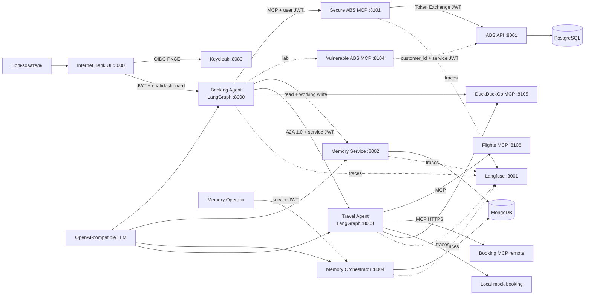

# Agentic Banking Lab

Запускаемый локальный стенд для исследований безопасности, наблюдаемости и интероперабельности ИИ-агентов. В нём разделены UI интернет-банка, банковский LangGraph-агент, MCP-фасад, АБС, PostgreSQL, оркестратор памяти, партнёрский тревел-агент, Keycloak и Langfuse.

Банковский агент, тревел-агент и оркестратор памяти обязательно используют LLM через
официальную библиотеку `openai`. Провайдер задаётся через `OPENAI_BASE_URL`; скрытого
детерминированного fallback нет. DuckDuckGo работает как отдельный live MCP. Перелёты
предоставляет отдельный моковый Flights MCP с синтетическими рейсами и ценами, а отели — удалённый read-only
Booking.com MCP от HasData. Бронирование — локальный мок Travel Agent, коммерческие операции
не выполняются. Два MCP к АБС дают сравнить образцовый
Token Exchange с намеренным broken-access-control антипримером.

## Архитектура



Главные границы намеренно вынесены в отдельные контейнеры:

- `ui` — статический Интернет-Банк и чат, OIDC Authorization Code + PKCE;
- `banking-agent` — LLM-граф `recall → LLM classify → skill → LLM answer → persist`, без прямого доступа к БД;
- `abs-mcp` — образцовый MCP: user token → Keycloak Token Exchange → АБС;
- `abs-mcp-vulnerable` — намеренно принимает `customer_id` от LLM и использует
  over-privileged service identity;
- `abs-api` — транзакционный backend АБС и единственный владелец банковской схемы PostgreSQL;
- `memory-service` — рабочая память, история сессий и только чтение долгосрочных слоёв через embedding-поиск; доступен банковскому агенту;
- `memory-orchestrator` — отдельный LLM-агент control plane: каждые 30 минут или по операторскому API переносит факты из working memory в episodic/semantic/procedural; банковскому агенту недоступен;
- `travel-agent` — отдельный LLM/LangGraph-агент с A2A 1.0 Agent Card;
- `duckduckgo-mcp` — live web/news search для банковского и тревел-агента;
- `flights-mcp` — собственный read-only мок внешнего провайдера авиабилетов, отдельный контейнер и bearer secret;
- `Booking MCP` — настоящий удалённый read-only MCP HasData;
- `travel-agent` — содержит локальный мок бронирования без внешних side effects;
- `keycloak` — пользовательские и межсервисные токены;
- `langfuse-web`, `langfuse-worker` — трассы, плюс ClickHouse, Redis и SeaweedFS.

Подробности: [архитектура](docs/ARCHITECTURE.md), [безопасность](docs/SECURITY.md), [память](docs/MEMORY.md), [MCP/A2A](docs/INTEROPERABILITY.md), [эксперименты](docs/EXPERIMENTS.md).

## Быстрый запуск

Нужны Docker с Compose v2, не менее 8 ГБ свободной RAM и свободные порты `3000`,
`3001`, `8000–8004`, `8080`, `8101`, `8104–8106`, `9090`. Первый запуск скачивает образы и обычно
занимает несколько минут.

```bash
cp .env.example .env
# заполните OPENAI_API_KEY и HASDATA_API_KEY
docker compose up --build -d
docker compose ps
```

Для обновления существующего стенда используйте [порядок переноса хранилища](docs/RUNBOOK.md#обновление-существующего-стенда-на-seaweedfs-и-flights-mcp):
он сохраняет прежние S3-объекты Langfuse и освобождает порты заменяемых контейнеров.

`OPENAI_BASE_URL` может указывать на OpenAI API или совместимый Chat Completions endpoint.
Если локальный провайдер не проверяет ключ, всё равно задайте непустой placeholder в
`OPENAI_API_KEY`, поскольку отсутствие конфигурации трактуется как недоступность LLM.
`OPENAI_JSON_MODE=false` отключает параметр `response_format` для провайдера, который его не
поддерживает; модель всё равно обязана вернуть JSON по переданной схеме.
`EMBEDDING_MODEL` задаёт OpenAI-compatible embedding-модель на том же `OPENAI_BASE_URL`.
Без доступных embeddings recall возвращает явную ошибку; скрытого fallback нет.

Для поиска отелей нужен `HASDATA_API_KEY` (Booking MCP). Без него источник явно появится
в `search_errors` как недоступный. Авиабилетный мок работает без внешней сети и API-ключей
авиакомпаний; `FLIGHTS_MCP_AUTH_TOKEN` должен совпадать у Flights MCP и Travel Agent.

Откройте:

- Интернет-Банк: <http://localhost:3000>
- Keycloak: <http://localhost:8080> (`admin` / `admin`)
- Langfuse: <http://localhost:3001> (`researcher@example.test` / `langfuse`)
- OpenAPI банковского агента: <http://localhost:8000/docs>
- Agent Card тревел-агента: <http://localhost:8003/.well-known/agent-card.json>

Тестовые пользователи:

| Login | Password | Customer |
|---|---|---|
| `ivan.petrov` | `banking-demo` | `customer-001` |
| `anna.sokolova` | `banking-demo` | `customer-002` |
| `mikhail.orlov` | `banking-demo` | `customer-003` |
| `elena.smirnova` | `banking-demo` | `customer-004` |

`keycloak-configurator` создаёт/обновляет их и настройки Token Exchange даже при уже
существующем volume Keycloak.

Проверка готовности и базовых сценариев выполняет реальные LLM-вызовы и требует доступного
провайдера:

```bash
python -m venv .venv
source .venv/bin/activate
pip install -r requirements-dev.txt
python scripts/smoke_test.py
pytest -q
```

Smoke-тест только подготавливает денежную операцию. Для явной проверки реального списания на 1 RUB используйте `python scripts/smoke_test.py --confirm`; это изменит локальные тестовые данные.

Остановка без удаления данных:

```bash
docker compose down
```

Полный сброс данных — намеренно отдельная разрушительная команда: `make reset`.

## Что умеет банковский агент

- профиль, счета, остатки и история операций;
- список инвестиционных продуктов, портфель и новости DuckDuckGo;
- подготовка перевода, оплаты услуги и покупки инвестиционного продукта;
- обязательное отдельное подтверждение активной операции, TTL 15 минут и идемпотентное исполнение;
- планирование поездки через A2A-вызов партнёрского агента;
- семантическая, процедурная, эпизодическая и рабочая память;
- полный журнал реплик, создание новых диалогов и возврат к предыдущим сессиям;
- LLM-миграция working memory в знания о пользователе, среде и навыках раз в 30 минут или по операторскому API;
- Langfuse-трассы для turn, MCP tool call, A2A и операций памяти.

Оба MCP АБС имеют инструменты `get_customer_info`, `get_customer_accounts`,
`get_operations_history`, `create_transfer`, `pay_service`, `list_investment_products`,
`get_portfolio`, `buy_investment_product`. Только у намеренно уязвимого сервера в arguments
есть `customer_id`.

## Важные ограничения стенда

Это учебная конфигурация, не production banking:

- Keycloak запущен в `start-dev`, пароли и секреты в `.env.example` публичны;
- TLS, WAF, rate limits, SIEM и HSM не включены;
- схемы АБС создаются через `create_all`, а не миграциями;
- рекомендации по направлениям формирует LLM тревел-агента из live DuckDuckGo MCP, без заранее подготовленных ответов; бронирование — локальный мок Travel Agent;
- Booking MCP read-only и не создаёт бронь; HasData расходует credits на успешные вызовы;
- Flights MCP возвращает только синтетические рейсы и цены с `synthetic=true` и `mode=mock-external-mcp`;
- DuckDuckGo и Booking MCP зависят от внешней сети и явно сообщают о недоступности;
- endpoints `/v1/lab/*`, shared write и `abs-mcp-vulnerable` намеренно небезопасны;
- долгосрочная память использует cosine similarity по embeddings; модель и совместимый endpoint задаются через `EMBEDDING_MODEL` и `OPENAI_BASE_URL`;
- при отсутствии/ошибке LLM chat возвращает `502/503`, а UI явно показывает, что ИИ недоступен;
- UI показывает исследовательские `tool_calls`; в пользовательском production-интерфейсе это обычно скрывают.

Для изменения секретов сервисных клиентов меняйте `.env` **до первого запуска**: realm использует подстановку переменных при импорте. Если realm уже был импортирован, выполните осознанный `make reset` либо обновите clients через Keycloak Admin Console.

## Структура

```text
services/
  banking_agent/       LangGraph и навыки банка
  travel_agent/        A2A-сервер и LangGraph партнёра
  abs_mcp/             Secure MCP АБС с Token Exchange
  abs_mcp_vulnerable/  Broken access control anti-pattern
  duckduckgo_mcp/      Live web/news MCP
  flights_mcp/         Мок внешнего MCP авиабилетов с отдельной аутентификацией
  abs_service/         backend АБС и SQL-модели
  memory_service/      data plane памяти и отдельный LLM-оркестратор
  common/              Keycloak, MCP client/server, tracing
infra/                 Keycloak realm, PostgreSQL init, nginx
ui/                    Интернет-Банк и чат
scripts/               smoke-тест
tests/                 unit/contract tests
docs/                  проектная и эксплуатационная документация
```

## Нормативные ориентиры

Реализация следует публичным интерфейсам [OpenAI Python SDK](https://developers.openai.com/api/docs/libraries), [MCP](https://modelcontextprotocol.io/specification/2025-06-18), [A2A 1.0](https://a2a-protocol.org/latest/specification), [Keycloak realm import](https://www.keycloak.org/server/importExport), [LangGraph](https://langchain-ai.github.io/langgraph/) и [Langfuse self-hosting](https://langfuse.com/self-hosting). Версии образов и Python-диапазоны находятся в `docker-compose.yml` и `requirements.txt`. SeaweedFS закреплён на версии `4.51` и запускается в режиме [`weed mini`](https://github.com/seaweedfs/seaweedfs/wiki/Quick-Start-with-weed-mini) с S3 bucket `langfuse`.
