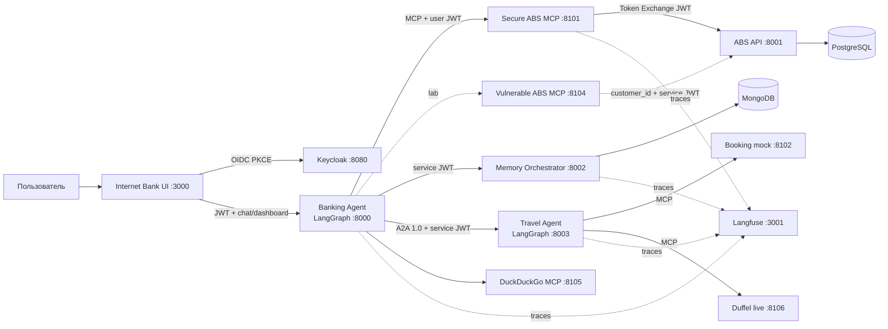

# Agentic Banking Lab

Запускаемый локальный стенд для исследований безопасности, наблюдаемости и интероперабельности ИИ-агентов. В нём разделены UI интернет-банка, банковский LangGraph-агент, MCP-фасад, АБС, PostgreSQL, оркестратор памяти, партнёрский тревел-агент, Keycloak и Langfuse.

Стенд работает без LLM-ключа: маршрутизация намерений и критические переходы
детерминированы. DuckDuckGo работает как отдельный live MCP. Реальные сведения о рейсах и
отелях получает Duffel Flights/Stays MCP при наличии access token; Booking остаётся воспроизводимым
моком, коммерческие бронирования не выполняются. Два MCP к АБС дают сравнить образцовый
Token Exchange с намеренным broken-access-control антипримером.

## Архитектура



Главные границы намеренно вынесены в отдельные контейнеры:

- `ui` — статический Интернет-Банк и чат, OIDC Authorization Code + PKCE;
- `banking-agent` — граф `recall → classify → skill → persist`, без прямого доступа к БД;
- `abs-mcp` — образцовый MCP: user token → Keycloak Token Exchange → АБС;
- `abs-mcp-vulnerable` — намеренно принимает `customer_id` от LLM и использует
  over-privileged service identity;
- `abs-api` — транзакционный backend АБС и единственный владелец банковской схемы PostgreSQL;
- `memory-orchestrator` — четыре типа памяти в MongoDB с обязательными `agent_id` и `user_id`;
- `travel-agent` — отдельный LangGraph-агент с A2A 1.0 Agent Card;
- `duckduckgo-mcp` — live web/news search;
- `travel-data-mcp` — live Duffel flights/stays при наличии access token;
- `booking-mcp`, `expedia-mcp` — моковые провайдеры бронирования/рекомендаций;
- `keycloak` — пользовательские и межсервисные токены;
- `langfuse-web`, `langfuse-worker` — трассы, плюс ClickHouse, Redis и MinIO.

Подробности: [архитектура](docs/ARCHITECTURE.md), [безопасность](docs/SECURITY.md), [память](docs/MEMORY.md), [MCP/A2A](docs/INTEROPERABILITY.md), [эксперименты](docs/EXPERIMENTS.md).

## Быстрый запуск

Нужны Docker с Compose v2, не менее 8 ГБ свободной RAM и свободные порты `3000`,
`3001`, `8000`, `8003`, `8080`, `8101–8106`. Первый запуск скачивает образы и обычно
занимает несколько минут.

```bash
cp .env.example .env
docker compose up --build -d
docker compose ps
```

Откройте:

- Интернет-Банк: <http://localhost:3000>
- Keycloak: <http://localhost:8080> (`admin` / `admin`)
- Langfuse: <http://localhost:3001> (`researcher@example.test` / `langfuse`)
- OpenAPI банковского агента: <http://localhost:8000/docs>
- Agent Card тревел-агента: <http://localhost:8003/.well-known/agent-card.json>

Тестовые пользователи:

| Login | Password | Customer |
|---|---|---|
| `ivan.petrov` | `banking-demo` | `customer-001` |
| `anna.sokolova` | `banking-demo` | `customer-002` |
| `mikhail.orlov` | `banking-demo` | `customer-003` |
| `elena.smirnova` | `banking-demo` | `customer-004` |
| `researcher` | `research-demo` | `customer-002` |

`keycloak-configurator` создаёт/обновляет их и настройки Token Exchange даже при уже
существующем volume Keycloak.

Проверка готовности и базовых сценариев:

```bash
python -m venv .venv
source .venv/bin/activate
pip install -r requirements-dev.txt
python scripts/smoke_test.py
pytest -q
```

Smoke-тест только подготавливает денежную операцию. Для явной проверки реального списания на 1 RUB используйте `python scripts/smoke_test.py --confirm`; это изменит локальные тестовые данные.

Остановка без удаления данных:

```bash
docker compose down
```

Полный сброс данных — намеренно отдельная разрушительная команда: `make reset`.

## Что умеет банковский агент

- профиль, счета, остатки и история операций;
- список инвестиционных продуктов, портфель и новости DuckDuckGo;
- подготовка перевода, оплаты услуги и покупки инвестиционного продукта;
- обязательное отдельное подтверждение активной операции, TTL 15 минут и идемпотентное исполнение;
- планирование поездки через A2A-вызов партнёрского агента;
- семантическая, процедурная, эпизодическая и рабочая память;
- Langfuse-трассы для turn, MCP tool call, A2A и операций памяти.

Оба MCP АБС имеют инструменты `get_customer_info`, `get_customer_accounts`,
`get_operations_history`, `create_transfer`, `pay_service`, `list_investment_products`,
`get_portfolio`, `buy_investment_product`. Только у намеренно уязвимого сервера в arguments
есть `customer_id`.

## Важные ограничения стенда

Это учебная конфигурация, не production banking:

- Keycloak запущен в `start-dev`, пароли и секреты в `.env.example` публичны;
- TLS, WAF, rate limits, SIEM и HSM не включены;
- схемы АБС создаются через `create_all`, а не миграциями;
- Booking/Expedia возвращают детерминированные синтетические данные; бронирование — мок;
- Duffel live требует `DUFFEL_ACCESS_TOKEN` и доступ к Stays; без них явно
  используется mock fallback;
- DuckDuckGo зависит от внешней сети и мягко деградирует при её отсутствии;
- endpoints `/v1/lab/*`, shared write и `abs-mcp-vulnerable` намеренно небезопасны;
- память использует лексическое ранжирование; интерфейс допускает замену на Atlas Vector Search или mem0;
- UI показывает исследовательские `tool_calls`; в пользовательском production-интерфейсе это обычно скрывают.

Для изменения секретов сервисных клиентов меняйте `.env` **до первого запуска**: realm использует подстановку переменных при импорте. Если realm уже был импортирован, выполните осознанный `make reset` либо обновите clients через Keycloak Admin Console.

## Структура

```text
services/
  banking_agent/       LangGraph и навыки банка
  travel_agent/        A2A-сервер и LangGraph партнёра
  abs_mcp/             Secure MCP АБС с Token Exchange
  abs_mcp_vulnerable/  Broken access control anti-pattern
  duckduckgo_mcp/      Live web/news MCP
  travel_data_mcp/     Live Duffel flights/stays MCP
  booking_mcp/         Booking-compatible lab adapter
  expedia_mcp/         Expedia-compatible lab adapter
  abs_service/         backend АБС и SQL-модели
  memory_service/      оркестратор памяти MongoDB
  common/              Keycloak, MCP client/server, tracing
infra/                 Keycloak realm, PostgreSQL init, nginx
ui/                    Интернет-Банк и чат
scripts/               smoke-тест
tests/                 unit/contract tests
docs/                  проектная и эксплуатационная документация
```

## Нормативные ориентиры

Реализация следует публичным интерфейсам [MCP](https://modelcontextprotocol.io/specification/2025-06-18), [A2A 1.0](https://a2a-protocol.org/latest/specification), [Keycloak realm import](https://www.keycloak.org/server/importExport), [LangGraph](https://langchain-ai.github.io/langgraph/) и [Langfuse self-hosting](https://langfuse.com/self-hosting). Зафиксированные версии образов и Python-диапазоны находятся в `docker-compose.yml` и `requirements.txt`.
