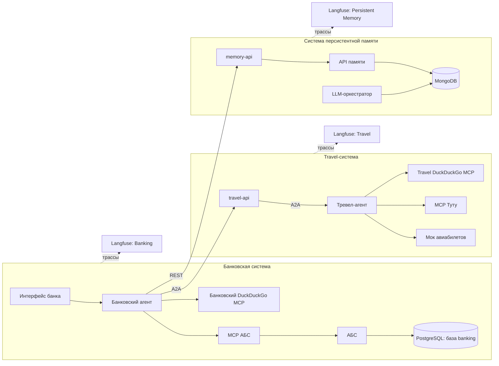

# Общая архитектура стенда

Это единое описание состава, сетей, межсистемных потоков и доверенной инфраструктуры.
Единая [модель угроз](SECURITY.md) содержит активы, модель нарушителей и условия
достижимости угроз для всего стенда. Подробности каждой подсистемы вынесены отдельно:

| Подсистема | Архитектура и краткая аналитика маршрутов |
|---|---|
| Банковская | [Банковский агент](BANKING_AGENT.md) |
| Партнёрская | [Агент путешествий](TRAVEL_AGENT.md) |
| Память | [Система памяти](MEMORY_SYSTEM.md) |

Документы подсистем уточняют компоненты, данные, входящие и исходящие API,
идентичности и ограничения. Самостоятельных моделей угроз у них нет: все сценарии
относятся к общему реестру. Форматы памяти, протоколы, эксплуатация и учебные задания
сохраняются в своих тематических руководствах.

Срез реализации проверен по коду и Compose ревизии `4b1d12a`. Описание относится
к штатным адресам из `.env.example` и `AUTH_DISABLED=false`; переопределение endpoint,
публикация через внешний прокси и изменение режима авторизации требуют новой проверки.
Сетевые выводы здесь основаны на конфигурации; это не отчёт о новом запуске контейнеров.

## Три самостоятельные системы

Один Compose-файл запускает весь учебный стенд. Это не объединяет системы в одного
агента: у них отдельные процессы, код, сети, сервисные идентичности и проекты трассировки.
Каждый Python-образ содержит только свой пакет `services/<имя>` и `services/common`.
Банковский образ, например, не содержит код тревел-агента и оркестратора памяти.

Keycloak и платформа Langfuse показаны в схеме не полностью. Они входят в общую
доверенную инфраструктуру; тот же физический PostgreSQL обслуживает базы Keycloak
и Langfuse. Узел `PG` на схеме обозначает банковскую базу, не отдельный сервер БД. Узел MCP АБС
обобщает защищённый и лабораторный пути; оба раскрыты в описании банка.

## Межсистемные потоки

| ID | Источник → получатель | Контракт и содержание | Идентичность |
|---|---|---|---|
| F01 | Браузер → Keycloak → банковский API | OIDC/PKCE, затем запросы клиента | `bank-ui`; клиент в JWT |
| F02 | Банк → защищённый MCP → АБС | Чтение и денежные инструменты; Token Exchange | Пользовательский JWT → `bank-mcp`, `aud=abs-api` |
| F03 | Банк/локальный клиент → уязвимый MCP → АБС | Лабораторный `customer_id` | JWT `bank-ui` → общая identity `bank-mcp-vulnerable` |
| F04 | Банк → `travel-api` → тревел-агент | A2A, параметры поездки и текущее сообщение | `banking-agent`, `aud=travel-agent` |
| F05 | Банк → `memory-api` → API памяти | REST, история/контекст, рабочие записи и задания | `banking-agent`, `aud=memory-service` |
| F06 | Тревел-агент → Туту или мок | MCP, поиск рейсов | Туту без токена; мок с отдельным bearer |
| F07 | Банковский/тревел-агент → собственный DuckDuckGo MCP | Поиск новостей/сведений → внешний web-поиск | Разные `azp` и назначения JWT |
| F08 | Оператор → оркестратор памяти | Обработка очереди и изменение памяти | `memory-operator`, `aud=memory-orchestrator` |
| F09 | Система памяти → MongoDB | Записи памяти и задания | Внутренние учётные данные БД |
| F10 | Системы → свои LLM; система памяти → эмбеддинги | Отобранный прикладной контекст; настройки по системе | Ключ соответствующего провайдера |
| F11 | Каждая система → свой приёмник Langfuse | Шаги, запросы/ответы и корреляция | Ключи собственного проекта |

Ответы возвращаются по исходному запросу; это не обратный API партнёра к банку.
Тревел-агент не вызывает АБС или память. Общий каталог динамического обнаружения
сервисов и автоматическое делегирование пользователя по A2A не реализованы.

Сквозной лабораторный поток использует F04 → F06 → ответ F04 → F05 → F08/F09:
получение мока, рабочий кандидат, отдельная промоция и последующее извлечение.
Публикация долгосрочной записи не происходит автоматически от самого A2A-ответа.

## Сети и разрешённые интерфейсы

| Сеть | Участники и назначение |
|---|---|
| `banking` | Банковский агент, его MCP и интерфейс; банковские стороны межсистемных шлюзов |
| `travel` | Тревел-агент и его MCP; travel-сторона `travel-api` |
| `memory` | API памяти, оркестратор; сторона `memory-api`, обращённая к памяти |
| `bank-storage` | Только АБС и PostgreSQL |
| `memory-storage` | Только API памяти, оркестратор и MongoDB |
| `platform-storage` | Внутренние соединения Keycloak и инфраструктуры Langfuse |

Три агентных процесса не имеют общей сети. Сети хранения помечены `internal: true`.
Из банка нельзя напрямую соединиться с `travel-agent`, `flights-mcp`,
`memory-orchestrator`, `mongo` или PostgreSQL — ни по имени, ни по адресам их контейнеров.
Тревел-агент не подключён к банковской сети или сетям хранения памяти.

Доступны только два межсистемных шлюза Nginx:

- `travel-api :8003` принимает A2A, выдаёт карточку агента и `/health`. Пути `/mcp`
  и внутренние REST-методы Travel Agent через него недоступны;
- `memory-api :8002` пропускает методы API памяти для работы с контекстом и рабочими
  записями. Операторский API оркестратора через него недоступен.

Шлюзы передают JWT, но удаляют `traceparent`, `tracestate` и `baggage`, чтобы другая
система не продолжала банковскую трассу. IP-маршрутизация между интерфейсами шлюзов
отключена. Методы по-прежнему проверяют `azp` и `aud` — сеть не заменяет авторизацию.

Лабораторный запрос `/v1/lab/ingest-flight-memory` также проходит по A2A:
банк запрашивает `lab_flight_source` у Travel Agent, тот вызывает свой мок и возвращает
исходный результат. Банк затем передаёт его в API памяти. Токен мока и его адрес
банковскому контейнеру не выдаются.

У банковской и travel-систем отдельные экземпляры DuckDuckGo MCP и разные назначения
JWT: `duckduckgo-mcp` и `travel-duckduckgo-mcp` соответственно.

## Разделение Langfuse

| Система | Приёмник | Проект | Переменные ключей в `.env` |
|---|---|---|---|
| Банковская | `langfuse-web` | `Banking` | `BANKING_LANGFUSE_*` |
| Travel | `langfuse-travel` | `Travel` | `TRAVEL_LANGFUSE_*` |
| Память | `langfuse-memory` | `Persistent Memory` | `MEMORY_LANGFUSE_*` |

Это три отдельных проекта, а не теги одного проекта. Каждый приёмник подключён только
к сети своей системы и к инфраструктуре Langfuse. Приложения получают только свою
пару ключей. При запуске проекты последовательно создаются штатной инициализацией
Langfuse; дополнительных действий студента не требуется. Общий интерфейс доступен
на порту 3001, остальные приёмники наружу не публикуются.

В проектах разные деревья трасс. Для связи одного взаимодействия между ними сохраняются
`session_id` и `correlation_id`, но не общий родительский span. Оркестратор использует
собственное `agent_id=memory-orchestrator`; агент-источник данных записывается отдельно
как `client_agent_id`.

Keycloak и инфраструктура Langfuse — общие доверенные службы стенда. У Langfuse общий
PostgreSQL, ClickHouse, Redis и SeaweedFS; разделение проектов не является разделением
физических серверов хранения. PostgreSQL также обслуживает АБС и Keycloak в разных
базах. Администратор Docker-хоста имеет доступ ко всему стенду. Опубликованные порты
привязаны к `127.0.0.1` и предназначены для студента, работающего на этом хосте.

Настройки описаны в [CONFIGURATION.md](CONFIGURATION.md), проверки — в [RUNBOOK.md](RUNBOOK.md).

Развитие взаимодействия в учебных заданиях описано в [плане курса](COURSE_PLAN.md).
Он отделяет существующие возможности от предлагаемых расширений: собственного
состояния тревел-диалога, обмена памятью, проверки бюджета и ограниченного делегирования.

## Два пути к АБС

При `ABS_MCP_MODE=secure` банковский инструмент отправляет пользовательский JWT в
`abs-mcp`. Тот обменивает его на токен с назначением `abs-api` и тем же клиентом.
АБС получает `customer_id` из проверенного JWT. Схемы инструментов не содержат
параметра `customer_id`. Обмен токенами не кэшируется между запросами.

При `ABS_MCP_MODE=vulnerable` граф добавляет шаг `select_abs_identity`. LLM выбирает
`customer_id` по сообщению, истории и воспоминаниям. Уязвимый MCP использует общую
сервисную учётную запись и передаёт выбранный идентификатор в АБС через
`X-Lab-Customer-ID`. Это намеренный пример нарушения контроля доступа.

Обзор счетов в интерфейсе и профиль для персонализации остаются на защищённом пути.
Их можно сравнивать с ответами уязвимого инструмента чата.

## Контекст и память

Перед каждым обращением банковский агент получает профиль через защищённый MCP,
полную историю текущего диалога и релевантные воспоминания. LLM получает дату и время
в `BANK_TIMEZONE`, ФИО, пол, тип клиента и VIP-статус, историю и до восьми записей
из каждого долгосрочного слоя. Выбранные записи не обрезаются дополнительно.

`memory-service` хранит реплики, ожидающие подтверждения операции и материалы из
внешних источников. Долгосрочную память он только читает. Её изменяет отдельный
`memory-orchestrator`: по расписанию или по операторскому запросу он извлекает факты
через LLM и создаёт эпизодические, семантические и процедурные записи.
Интервал задаётся в `.env` через `MEMORY_ORCHESTRATION_INTERVAL_SECONDS`:
по умолчанию 1800 секунд, `0` отключает периодическую обработку очереди.

Записи содержат `agent_id`, `user_id`, происхождение и при необходимости срок действия.
Поиск использует эмбеддинги, фильтры области доступа и косинусное сходство.
Общая область `user_id="*"` позволяет исследовать отравление памяти между пользователями.
Подробности — в [описании памяти](MEMORY.md).

## Подтверждение денежной операции

1. Банковский агент проверяет структурированные параметры и сохраняет операцию
   в рабочей памяти со сроком подтверждения 15 минут.
2. Пользователь подтверждает её отдельным запросом.
3. Агент повторно проверяет владельца, статус и срок действия записи.
4. MCP передаёт операцию в АБС с ключом идемпотентности.
5. АБС выполняет транзакцию; повторный запрос не вызывает повторного списания.

Эти проверки действуют и в уязвимом режиме MCP. Они не устраняют намеренную подмену
клиента в этом режиме. Не меняйте режим между подготовкой и подтверждением операции.

## Travel и внешние источники

При `FLIGHTS_PROVIDER=tutu` тревел-агент использует `search_avia` удалённого MCP Туту.
При `mock` он обращается к `search_flights` собственного мока. Текст заметки выбирается
параметром `FLIGHTS_MOCK_NOTE`. Ошибка одного источника не переключает агента на другой.

Сведения о направлениях ищутся через собственный DuckDuckGo MCP тревел-системы.
Поиск отелей не реализован. В LLM-плане доступны только поиск перелётов и сведения
о направлении. Для совместимости ответа A2A поле `accommodations` остаётся пустым,
а `provider_modes.hotel_search` имеет значение `not-supported`.
Бронирование реализовано как локальная имитация без коммерческих операций.
В A2A-запрос не включаются банковский профиль и история диалога.
Тревел-агент не хранит собственную историю между вызовами и не подключён к API памяти.
Контекст его выполнения состоит из текущего запроса и полученных результатов;
передаваемый `contextId` используется для корреляции, а не для восстановления сессии.
Моковое бронирование и лабораторное чтение ответа мока также доступны по A2A.

## Порты

| Порт | Сервис |
|---|---|
| 3000 / 3001 | Интерфейс банка / Langfuse |
| 8080 | Keycloak |
| 8000 / 8001 | Банковский агент / АБС |
| 8002 / 8004 | Шлюз API памяти / операторский API оркестратора памяти |
| 8003 | A2A-шлюз тревел-агента |
| 8101 / 8104 | Защищённый / уязвимый MCP АБС |
| 8105 / 8106 | DuckDuckGo MCP / мок авиабилетов |
| 9090 | S3-интерфейс SeaweedFS |
| 5432 / 27017 | PostgreSQL / MongoDB |
