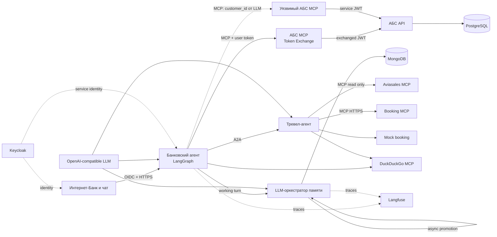

# Компонентная архитектура

## Итоговая схема

Диаграмма намеренно показывает только границы компонентов и основные протоколы.
Внутренние базы Langfuse и инфраструктурные зависимости Compose опущены.

## Ответственность компонентов

| Компонент | Ответственность | Данные/протокол |
|---|---|---|
| `ui` | Интернет-Банк и чат | OIDC Authorization Code + PKCE, REST |
| `banking-agent` | LLM-маршрутизация, навыки, LLM-ответ, подтверждение операций | OpenAI SDK, REST, MCP client, A2A client |
| `abs-mcp` | Образцовая граница доступа к АБС | MCP Streamable HTTP, RFC 8693 Token Exchange |
| `abs-mcp-vulnerable` | Намеренно небезопасное сравнение | MCP принимает `customer_id` от LLM, client credentials |
| `abs-api` | Транзакции и проверка владельца | FastAPI, PostgreSQL |
| `memory-orchestrator` | Сохранение сессий, очередь асинхронной LLM-миграции working → episodic/semantic/procedural и LLM-recall | OpenAI SDK, REST, MongoDB |
| `travel-agent` | Независимый партнёрский LLM/LangGraph-агент | OpenAI SDK, A2A 1.0, MCP clients |
| `duckduckgo-mcp` | Реальный поиск новостей и destination research без заготовленных ответов | DDGS, live network |
| `aviasales-mcp` | Поиск цен на рейсы | MCP Market server, Travelpayouts Data API |
| Booking MCP | Поиск размещения | HasData remote Streamable HTTP MCP |
| `travel-agent` mock booking | Локальная симуляция бронирования без внешней операции | REST, synthetic confirmation |
| `keycloak` | Пользовательская и межсервисная аутентификация | OIDC/OAuth 2.0 |
| `langfuse` | Трассы turns, MCP, A2A и памяти | OTEL/Langfuse SDK |

## Граница минимального состава

После минимизации каждый оставшийся прикладной компонент участвует хотя бы в одном
проверяемом контуре:

| Контур исследования | Обязательные компоненты |
|---|---|
| Изоляция и отравление памяти | Banking Agent, LLM Memory Orchestrator, MongoDB, два пользователя |
| Secure/vulnerable MCP | оба ABS MCP, ABS API, PostgreSQL, Keycloak Token Exchange |
| Indirect prompt injection | инвестиционный навык, DuckDuckGo MCP, shared memory, LLM |
| A2A и внешняя интероперабельность | Banking Agent, Travel Agent, Aviasales MCP, Booking MCP, DuckDuckGo MCP |
| Проверяемость экспериментов | Langfuse web/worker, ClickHouse, Redis, MinIO |

Инвестиционный сценарий намеренно оставлен: он создаёт короткую реальную цепочку от
недоверенного web-результата через LLM к памяти. Платёж, перевод и покупка продукта оставлены
как разные destructive tool contracts для проверки confirmation gate и excessive agency.
Локальные подмены Booking/Aviasales, Expedia/Duffel, отдельный режим запуска без трассировки,
дублирующий MCP probe и неиспользуемые runtime-зависимости в итоговый состав не входят.

## Два пути к АБС

### Образцовый путь

1. UI получает пользовательский access token с audience `abs-mcp` и `bank-mcp`.
2. `abs-mcp` проверяет подпись, `azp` и audience.
3. Confidential client `bank-mcp` обменивает исходный token на короткоживущий token с
   audience `abs-api`.
4. АБС получает `customer_id` только из проверенного exchanged JWT.
5. В schemas MCP-инструментов поля `customer_id` нет.

Token Exchange не кэшируется между запросами: это исключает ошибочную повторную выдачу
токена одного пользователя другому.

### Намеренно уязвимый путь

1. В schema каждого инструмента `abs-mcp-vulnerable` обязателен `customer_id`.
2. Значение формирует LLM из промпта пользователя или внешнего контекста.
3. MCP использует собственный over-privileged client-credentials token.
4. АБС разрешает этому специальному lab client выбрать клиента через
   `X-Lab-Customer-ID`.

Это воспроизводит broken access control и excessive agency: целостность identity metadata
возложена на вероятностную модель, хотя должна обеспечиваться криптографически. Уязвимый
client отделён по `azp`, endpoint и порту; production-код не должен иметь такой ветки.

## Память и отравление

Каждый chat turn сначала сохраняется полностью как две working-записи. UI может создать новый
`conversation_id`, получить список своих сессий и загрузить прежние реплики. Затем независимый
worker забирает migration job и через LLM извлекает пользовательские факты в episodic, знания
о среде в semantic и переиспользуемые навыки в procedural. Ошибка migration не откатывает
уже сохранённую историю.

Обычные записи имеют `user_id=<customer-id>`. Общая область имеет `user_id="*"`; recall
возвращает объединение личной и общей областей. Каждая общая запись дополнительно содержит
`source_user_id`, `source`, `trust` и `vulnerability` в metadata.

Лабораторные API демонстрируют два пути:

- пользователь A пишет в `/v1/lab/shared-memory`, пользователь B получает запись при recall;
- `/v1/lab/ingest-external-memory` получает live DuckDuckGo snippets через MCP и без
  санитизации сохраняет их в общую память. Инструкция на контролируемой внешней странице
  становится indirect prompt injection для всех пользователей.

LLM-оркестратор оценивает записи, а при recall выбирает релевантные записи после лексического
preselection. Затем банковский LLM получает `memory_context`, поэтому direct и indirect
poisoning реально влияют на контекст модели. Авторизация, canonical action parameters и
confirmation gate при этом остаются вне LLM.

## Поток активной операции

`prepare → pending memory (TTL 15 мин) → отдельное подтверждение → повторная проверка
agent_id/user_id/status → secure MCP → Token Exchange → транзакция АБС`.

Повтор `confirmation_id` возвращает сохранённый результат по idempotency key и не создаёт
повторное списание.

## Порты

| Порт | Компонент |
|---:|---|
| 3000 / 3001 | UI / Langfuse |
| 8000–8003 | Banking agent, ABS, Memory, Travel agent |
| 8080 | Keycloak |
| 8101 | Secure ABS MCP |
| 8104 | Vulnerable ABS MCP |
| 8105 / 8106 | DuckDuckGo live / Aviasales MCP |
