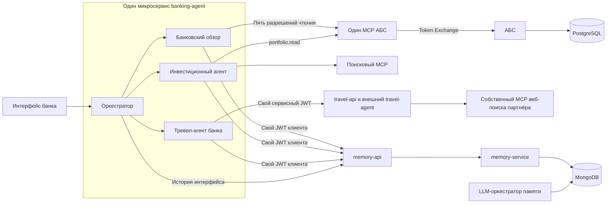

# Общая архитектура стенда

В одном микросервисе `banking-agent` работают оркестратор и три агента.
Оркестратор вызывает агента методом Python. Каждый агент использует собственную
учётную запись OAuth для обращения к сервисам. АБС с MCP, внешний тревел-партнёр
и память работают отдельно.

Подробности: [банковские агенты](BANKING_AGENT.md), [партнёр](TRAVEL_AGENT.md),
[память](MEMORY_SYSTEM.md), [контракты и OAuth](INTEROPERABILITY.md),
[модель угроз](SECURITY.md).

## Компоненты и полномочия

| Агент | OAuth-клиент | Разрешённые вызовы |
|---|---|---|
| Банковский обзор | `operations-skill` | MCP: профиль, счета, операции, выписки, портфель и продукты; только чтение; память |
| Инвестиционный | `investment-skill` | MCP: только `get_portfolio`, `portfolio.read`; поиск новостей; память |
| Тревел банка | `travel-skill` | A2A внешнему партнёру с `travel.plan`; память |

Имена `*-skill` обозначают клиентов Keycloak. Реализация агентов:
[`services/banking_agent/agents.py`](../services/banking_agent/agents.py).

У `abs-mcp` один адрес `:8101/mcp`: `tools/list` и исполнение фильтруются по
вызывающему клиенту и scope. АБС повторно проверяет scope ресурса и клиента JWT.
MCP использует свой `bank-mcp` для следующего Token Exchange, сохраняя необходимый scope.
Цепочка обмена описана в [INTEROPERABILITY.md](INTEROPERABILITY.md#oauth2-и-token-exchange).

Внешний `travel-agent` получает от банковского `travel-skill` параметры поездки.
У партнёра нет исходного пользовательского JWT, доступа к памяти банка или АБС.

## Контекст и память

Оркестратор видит текущее сообщение, наличие параметров поездки и предыдущий навык.
До выбора агента профиль и долговременная память в маршрутизирующую LLM не загружаются.
Агент читает личную историю и до восьми записей каждого долговременного слоя,
вызывает инструменты и возвращает результат оркестратору. Тот читает историю текущего
диалога, при необходимости вызывает других агентов и сам формирует финальный ответ.
Каждый агент вызывается не более одного раза; коллегам передаётся только исходная
задача, без чужих результатов. Оркестратор видит все полученные результаты.

Для MCP и памяти каждый агент обменивает JWT пользователя своими учётными
данными. Токен памяти содержит `aud=memory-service`, `memory.access` и `customer_id`.
Для поиска и A2A используются отдельные сервисные JWT соответствующих агентов.
Пользовательские обмены не кэшируются между запросами; сервисные токены кэшируются
в отдельных экземплярах клиентов.

`SKILL_MEMORY_MODE=shared` объединяет знания трёх агентов одного клиента в
`skills.shared`. `isolated` разделяет их по `skills.<identity>`.
История всегда личная: `skills.history.<identity>`, клиент и диалог.
Области `skills.*` не используют `user_id="*"`. Проверки допустимости общей публикации
нет: сведения об операциях могут попасть в память агента, которому
запрещён прямой инструмент операций. Изоляция разрывает межагентное чтение,
но не устраняет собственное отравление памяти.

Результаты инструментов становятся кандидатами; долговременные записи создаёт
отдельный `memory-orchestrator`. История интерфейса банка и прежних лабораторий
сохраняется отдельно в `banking-agent`. Форматы и происхождение записей описаны в [MEMORY.md](MEMORY.md).

## Сети и доверенные службы

| Сеть | Назначение |
|---|---|
| `banking` | Один банковский микросервис, банковские MCP, АБС, UI и стороны шлюзов |
| `travel` | Внешний тревел-агент, его инструменты и сторона `travel-api` |
| `memory` | API памяти, оркестратор памяти и сторона `memory-api` |
| `bank-storage` / `memory-storage` | АБС → PostgreSQL / сервисы памяти → MongoDB; внутренние сети |
| `platform-storage` | Общая инфраструктура Keycloak и Langfuse |

`travel-api:8003` пропускает A2A, Agent Card и `/health`;
`memory-api:8002` пропускает прикладные API памяти, без операторских методов.
JWT проверяет получатель. Шлюзы передают W3C `traceparent` и метки опыта; `baggage` удаляется.
Разные токены ограничивают доступ к API; секреты всех банковских агентов
находятся в одном процессе. Его компрометация затрагивает всех агентов.

Keycloak и Docker-хост общие для систем. Docker-сети разделяют подключения
контейнеров, но не фильтруют весь исходящий интернет-трафик.

## Langfuse

| Владелец | Приёмник | Проект и ключи |
|---|---|---|
| Банк | `langfuse-web` | `Banking`, `BANKING_LANGFUSE_*` |
| Организация-партнёр | `langfuse-travel` | `Travel`, `TRAVEL_LANGFUSE_*` |
| Сервис памяти | `langfuse-memory` | `Persistent Memory`, `MEMORY_LANGFUSE_*` |

Внутри системы входящий HTTP-запрос, OAuth, агенты, MCP и LLM образуют одно дерево.
Вызовы MCP/АБС того же владельца продолжают `traceparent`. На границе систем
получатель создаёт новую трассу в своём проекте и записывает `upstream_trace_id`,
`upstream_span_id`, `upstream_system_id`. Ключи Langfuse между системами не передаются.
`experiment_id`, `run_id` и ID диалога связывают опыт; фоновые задания имеют свои трассы.
У приёмников общие БД, очередь и хост. Проекты разделены логически;
физической изоляции организаций на стенде нет.
Перенос памяти проверяют по ID кандидата, задания, записи и `derived_from_job`.
Трассы содержат полные входы и выходы с маскированием структурированных секретов.
Langfuse не гарантирует неизменяемость журнала.
Настройки и диагностика: [CONFIGURATION.md](CONFIGURATION.md), [RUNBOOK.md](RUNBOOK.md).

## Прежние лаборатории и адреса

`BANKING_AGENT_MODE=legacy` включает старый граф с денежными подтверждениями.
`ABS_MCP_MODE=vulnerable` использует отдельный намеренно уязвимый MCP и
`X-Lab-Customer-ID`; `secure` использует JWT и проверку scope ресурса в общем MCP/АБС.
Денежные задачи в режиме оркестратора закрыты.
Dashboard и `/v1/lab/*` сохранены; защита токенов трёх агентов не устраняет учебные
уязвимости этих маршрутов. Прежняя область памяти допускает `user_id="*"`.

| Порт | Сервис |
|---|---|
| 3000 / 3001 | Интерфейс банка / Langfuse |
| 8080 | Keycloak |
| 8000 / 8001 | Банковский микросервис / АБС |
| 8002 / 8004 | Шлюз памяти / операторский API памяти |
| 8003 | A2A-шлюз партнёра |
| 8101 / 8104 | Общий защищённый / уязвимый MCP АБС |
| 8105 / 8106 | Банковский поиск / мок авиабилетов |
| 9090 | SeaweedFS S3 |
| 5432 / 27017 | PostgreSQL / MongoDB |

Порты привязаны к `127.0.0.1`. Отелей и реальной покупки авиабилетов нет;
бронирование имитируется локально. Опыты описаны в [EXPERIMENTS.md](EXPERIMENTS.md),
задания по развитию взаимодействия приведены в [COURSE_PLAN.md](COURSE_PLAN.md).
