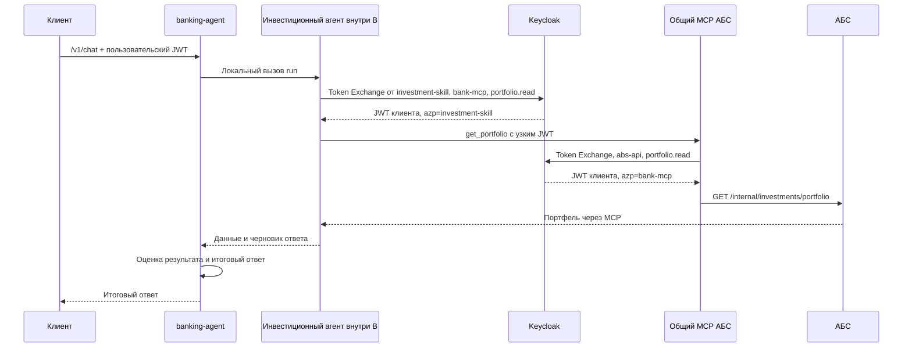

# Банковский микросервис: оркестратор и агенты

В `banking-agent` работают оркестратор и три агента с собственными учётными данными
Keycloak. Оркестратор вызывает агентов внутри процесса методами Python.
Сети описаны в [архитектуре](ARCHITECTURE.md), OAuth и схемы в [контрактах](INTEROPERABILITY.md).

## Полномочия

Ниже описан банковский путь при `ABS_MCP_MODE=secure`. При `vulnerable` агенты
операций и инвестиций используют отдельный MCP с ID клиента, переданным через LLM;
ограничения `portfolio.read` и других банковских scope на этом пути не действуют.

| Агент / OAuth-клиент | Инструменты |
|---|---|
| Банковский обзор / `operations-skill` | Профиль, счета и остатки, операции и выписки, портфель, каталог продуктов через MCP; только чтение; память |
| Инвестиционный / `investment-skill` | `abs-mcp.get_portfolio` с `portfolio.read`; `duckduckgo-mcp.news_search`; память |
| Тревел / `travel-skill` | A2A внешнему партнёру с собственным сервисным JWT и `travel.plan`; память |

Все три обращаются к памяти с `memory.access` и клиентом из делегированного JWT.
Их секреты передаются одному контейнеру, но каждый объект агента создаёт отдельные
`ServiceTokenProvider` и `TokenExchangeProvider` с собственным `client_id`.
Пользовательские обмены не кэшируются и не меняют конфигурацию другого агента.
Сервисные токены поиска/A2A кэшируются отдельно.

На одном MCP АБС список и вызовы инструментов зависят от клиента и scope:
инвестиционный токен даёт только `get_portfolio`, аналитический разрешает все шесть
инструментов чтения АБС. АБС повторно проверяет scope ресурса. При отказе авторизации
сервис возвращает ошибку и не подставляет более широкий токен.

Секреты всех агентов находятся в одном процессе. Его компрометация раскрывает
все эти учётные данные, несмотря на разные права токенов.

## Выписка и банковский обзор

`operations-skill` использует `get_customer_info`, `get_customer_accounts`,
`get_operations_history`, `get_account_statement`, `get_portfolio` и
`list_investment_products`. Оркестратор направляет ему запросы профиля и общего
банковского обзора. Анализ портфеля и рынков выполняет инвестиционный агент. Банковский аналитик читает все шесть источников,
извлекает фильтры выписки из сообщения и личной истории, затем формирует ответ.

Выписка принимает необязательные `account_id`, `date_from`, `date_to`, `limit`
(до 1000) и `offset`. Клиент определяется из JWT; чужой счёт недоступен.
Даты включительные, по Москве. Итоги поступлений и расходов рассчитывает АБС
по всем завершённым операциям периода отдельно для каждой валюты, независимо
от страницы выдачи. `has_more` отмечает неполный список операций. Остатки счетов
показывают текущее состояние; исторические остатки АБС не рассчитывает.

## Исполнение запроса

1. `/v1/chat` проверяет JWT клиента и задаёт `run_id` опыта.
2. Оркестратор выбирает первого исполнителя по сообщению, наличию `travel` и имени
   предыдущего навыка. Профиль и долговременная память на этом этапе не загружаются.
3. После выбора оркестратор читает историю текущего диалога для подготовки ответа.
   Агент вызывается локальным `SkillAgent.run` с исходным сообщением пользователя;
   структурированные параметры поездки передаются только `travel-skill`.
4. Исполнитель своими учётными данными обращается к памяти и разрешённым сервисам,
   ставит результаты в очередь кандидатов и возвращает данные и черновик ответа.
5. Оркестратор оценивает результат. При необходимости вызывает другого агента,
   затем повторно оценивает накопленные результаты. Каждый из трёх агентов может
   быть вызван не более одного раза за запрос.
6. Оркестратор формирует финальный ответ. Этот ответ сохраняется в истории
   интерфейса; в личной истории навыков остаются их собственные реплики.

Дополнительный агент получает исходную задачу, свою историю и доступную ему память.
Результаты коллег и общая история интерфейса ему не передаются. Итоговая LLM
оркестратора видит результаты всех вызванных агентов и историю текущего диалога.
JWT используется только серверным кодом.

При `general` оркестратор может ответить без вызова агентов. Структурированный
`travel` выбирает тревел-агента первым. `action`/`confirm_action_id` отклоняются
с `409`; денежные инструменты агентам не выданы.

## Контекст и память

Маршрутизатор до выбора агента не загружает профиль или долговременную память.
Агент получает своё сообщение, историю и до восьми записей каждого долговременного слоя.
Банковский аналитик читает профиль, счета, операции, выписку, портфель и продукты.
У остальных агентов нет прямого инструмента чтения профиля.
`shared` объединяет знания трёх агентов одного клиента, `isolated` разделяет их;
история всегда личная.
Сведения об операциях могут попасть инвестиционному агенту через общую память при
запрещённом прямом инструменте. [Опыт](EXPERIMENTS.md#межагентный-перенос-через-память)
проверяет эти два пути отдельно.

В кандидаты передаются до 12 000 символов каждого результата; полные результаты
сохраняются в `skill.sources`. Отдельный `memory-orchestrator` решает, создавать ли
по кандидату долговременную запись.
Инвестиционный поиск использует фиксированный запрос новостей без клиентского текста,
портфеля или памяти. Тревел-агент извлекает поездку по личной истории/памяти и дате
Москвы. Если данных не хватает, задаёт один-два вопроса и сохраняет ответ.
Для предварительного бюджета нужны направление (достаточно страны), город вылета,
период, длительность и число путешественников. Для поиска билетов нужны аэропорты
и дата вылета. Параметры хранятся в `travel_state` личной истории агента.
Короткое уточнение дополняет это состояние; известные аэропорты, даты и число людей
сохраняются, если модель их пропустила.
Для бюджета партнёру передаётся `budget_plan` с известными маршрутом и датами.
Если известны аэропорты и дата вылета, партнёр проверяет рейсы; при примерном
периоде собирает только сведения о расходах. `one_way` задаёт перелёт в одну сторону,
`stay_end_date` задаёт конец пребывания и не становится обратным рейсом.
Партнёру передаются параметры и `user_query` до 1000 символов.
Полная история и исходный банковский JWT в запрос не входят.

## Входящие API

| Маршрут | Назначение |
|---|---|
| `GET /health` | Режим агента, LLM и трассы |
| `POST /v1/chat` | Сообщение, необязательные `travel` и `experiment` |
| `GET /v1/conversations` и `/{conversation_id}/messages` | История интерфейса клиента |
| `GET /v1/dashboard` | Обзор через общий защищённый MCP; не загружается в маршрутизатор автоматически |
| `/v1/lab/*` | Прежние учебные маршруты: подмена клиента, кандидаты и извлечение `banking-agent` |

`SkillTask` задаёт данные локального вызова; HTTP-маршрута `/v1/task` нет.
Области памяти навыков отделены от `banking-agent`. Банковский API сохраняет
широкие сервисные права на прежние методы памяти для интерфейса и лабораторий.

## Прежний граф

`BANKING_AGENT_MODE=legacy` включает
`recall_memory → classify → навык → compose_response → persist_memory`.
В нём профиль, история и память читаются до выбора навыка.
`ABS_MCP_MODE=secure` использует общий защищённый MCP с Token Exchange;
в режиме `vulnerable` LLM получает ID авторизованного клиента и передаёт его в MCP;
MCP не сверяет выбранный ID с JWT и передаёт его в `X-Lab-Customer-ID`.
Тот же переключатель действует для банковских агентов режима `orchestrator`:
его маршрутизатор возвращает ID вместе с выбором навыка и передаёт его операционному
или инвестиционному агенту до вызова MCP.
Агент поездок не обращается к АБС.

Денежная операция хранится 15 минут с каноническими параметрами, подтверждается
отдельным запросом владельца и исполняется с ключом идемпотентности.
Прямой активный MCP не проверяет доказательство согласия чата. Ошибку после
фиксации операции проверяют по АБС; режим между подготовкой и подтверждением не меняют.

## Трассы и проверки

В `Banking` одно дерево запроса: `orchestrator.route`, `orchestrator.delegate`,
`skill.turn`, `skill.sources`, `orchestrator.compose`, LLM и вызовы сервисов. У агента свой `agent_id`;
обмены и отказы видны в `oauth.*`. Банковские MCP и АБС продолжают ту же трассу.
Партнёр и память записывают свои локальные деревья в собственные проекты;
`upstream_trace_id` и `upstream_span_id` ссылаются на банковский вызов.
Фоновый перенос памяти связан метками опыта и ID записей.
Завершённый ответ агента содержит `data.experiment`: режим, ID извлечений и кандидатов.
Ответ `general` или уточнение поездки может не содержать этот блок.
`data.agent_results` сохраняет ответы и данные каждого исполнителя отдельно,
`data.orchestration.delegated_agents` перечисляет вызванных агентов. Верхний уровень
`data` сохраняет данные первого исполнителя, `intent` обозначает этого исполнителя
или `general`, если агенты не вызывались. Поэтому одинаковые поля разных источников,
например `portfolio`, не перезаписывают друг друга.

Код: [оркестратор](../services/banking_agent/orchestrator.py),
[три агента](../services/banking_agent/agents.py),
[политика MCP/АБС](../services/common/banking_policy.py),
[OAuth](../services/common/oauth_config.py).
[Тесты](../tests/test_skill_authorization.py) проверяют ограничения MCP/АБС,
разные учётные данные и отсутствие смешения пользователей при параллельных обменах.

[Тесты оркестратора](../tests/test_orchestrator.py) проверяют итоговую генерацию,
дополнительные вызовы, передачу только исходной задачи и запрет повторного вызова.
