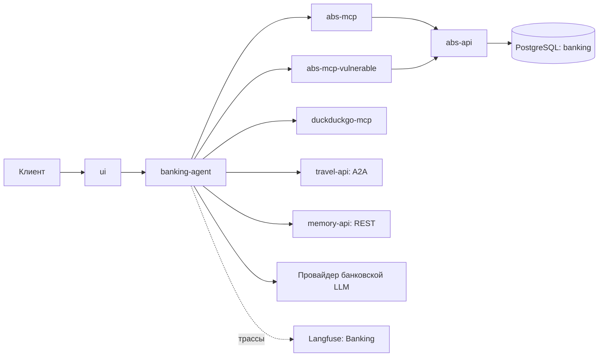

# Банковский агент: архитектура и маршруты

Документ описывает банковскую подсистему текущего стенда. Общие сети и внешние
границы определены в [архитектуре](ARCHITECTURE.md), активы, нарушители и сценарии
достижимости — в единой [модели угроз](SECURITY.md). Здесь рассматриваются устройство
подсистемы и доступные пути исполнения, без отдельной модели угроз.

## Назначение и состав

Банковский агент обслуживает чат клиента, показывает банковские сведения, ищет
инвестиционные новости, передаёт поиск поездки партнёру и подготавливает денежные
операции с отдельным подтверждением.

| Компонент | Назначение |
|---|---|
| `ui` | Статический интерфейс банка и OAuth/OIDC-клиент `bank-ui` |
| `banking-agent` | FastAPI и LangGraph: контекст, маршрутизация, навыки, ответы и история |
| `abs-mcp` | Защищённые банковские инструменты, обмен пользовательского JWT на токен АБС |
| `abs-mcp-vulnerable` | Лабораторный путь с `customer_id` в аргументах и общей сервисной идентичностью |
| `abs-api` | АБС: владение счетами, денежные операции, идемпотентность |
| `duckduckgo-mcp` | Собственный поиск банковской подсистемы |
| PostgreSQL, база `banking` | Клиенты, счета, операции, продукты, позиции и результаты исполненных действий |

Keycloak, провайдер LLM и Langfuse являются отдельными зависимостями. Физический
PostgreSQL общий с инфраструктурой стенда; банковские данные находятся в своей базе.
`banking-agent` не подключён напрямую к PostgreSQL или MongoDB.

Сеть приложений — `banking`; АБС дополнительно подключена к `bank-storage`.
Шлюзы `travel-api` и `memory-api` предоставляют ограниченные межсистемные интерфейсы.
Банковский контейнер содержит собственный пакет и общий код `services/common`.

## Входящие маршруты

Адрес агента на хосте — `http://localhost:8000`. UI на порту 3000 обращается к нему
из браузера. Защищённые методы требуют JWT с `azp=bank-ui`, `aud=banking-agent`.
В пользовательских маршрутах `user_id` определяется по привязке к клиенту в JWT.
Лабораторный `vulnerable-abs` намеренно использует выбранный в теле `customer_id`
вместо этой привязки.

| Маршрут | Что происходит | Особенность |
|---|---|---|
| `GET /health` | Готовность и публичные сведения о конфигурации | Без пользовательского JWT |
| `GET /v1/dashboard` | Профиль, счета, операции и портфель | Всегда защищённый MCP, независимо от режима чата |
| `GET /v1/conversations` | Список диалогов клиента | Банк подставляет клиента в запрос к API памяти |
| `GET /v1/conversations/{conversation_id}/messages` | История одного диалога | Область задаётся клиентом из JWT и ID диалога |
| `POST /v1/chat` | Запуск графа; текст, структурированные параметры или подтверждение | Текст не заменяет структурированный `action` |
| `POST /v1/lab/vulnerable-abs` | Чтение чужого профиля/счетов/операций через уязвимый MCP | Намеренная уязвимость, не зависит от `ABS_MCP_MODE` |
| `POST /v1/lab/shared-memory` | Кандидат памяти из пользовательского текста | Сначала рабочая запись и очередь, не готовое долговременное знание |
| `POST /v1/lab/ingest-external-memory` | Поиск DuckDuckGo и постановка внешнего текста в очередь | Ответ внешнего источника |
| `POST /v1/lab/ingest-flight-memory` | Получение сырого ответа мока через тревел-агента и постановка в очередь | A2A `lab_flight_source`; прямого MCP-соединения с моком нет |
| `GET /v1/lab/memory-recall` | Проверка извлечения воспоминаний | Используется клиент из JWT; общая область памяти видна намеренно |

## Исходящие маршруты и полномочия

| Маршрут | Идентичность | Передаваемые данные и результат |
|---|---|---|
| `banking-agent → abs-mcp:8101/mcp` | Пользовательский JWT: `azp=bank-ui`, `aud=abs-mcp` | Имя инструмента и параметры без `customer_id` |
| `abs-mcp → Keycloak → abs-api:8001/internal/*` | Обмен токена: `azp=bank-mcp`, `aud=abs-api`, клиент в JWT | АБС проверяет владельца по токену |
| `banking-agent → abs-mcp-vulnerable:8104/mcp` | Пользовательский JWT: `aud=bank-mcp-vulnerable` | В лабораторном режиме клиент выбирается LLM и передаётся аргументом |
| `abs-mcp-vulnerable → abs-api` | Сервисный токен `bank-mcp-vulnerable`, `aud=abs-api` | Клиент в `X-Lab-Customer-ID`; намеренное нарушение привязки субъекта |
| `banking-agent → memory-api:8002 → memory-service` | Сервисный токен `banking-agent`, `aud=memory-service` | Чтение контекста/истории, запись реплик, кандидатов и ожидающих действий |
| `banking-agent → travel-api:8003 → travel-agent` | Сервисный токен `banking-agent`, `aud=travel-agent` | Параметры поездки либо лабораторное чтение мока по A2A |
| `banking-agent → duckduckgo-mcp:8105/mcp` | Сервисный токен `banking-agent`, `aud=duckduckgo-mcp` | Запрос инвестиционных новостей или лабораторный поиск |
| `banking-agent → провайдер LLM` | Отдельная настройка `BANKING_OPENAI_*` либо общая `OPENAI_*` | Сообщение, профиль, история, воспоминания и данные выбранного навыка |
| Банковские сервисы → `langfuse-web` | Ключи проекта `Banking` | Трассы исполнения; ограничения маскировки описаны в общей модели угроз |

Передача пользовательского JWT защищённому MCP и использование сервисного токена
для A2A/памяти — разные способы вызова. Тревел-агенту пользовательский JWT не передаётся.

## Исполнение запроса и состояние

Граф выполняет `recall_memory → classify → select_abs_identity → выбранный навык →
compose_response → persist_memory`.

При загрузке контекста параллельно читаются профиль через защищённый MCP, полная
история текущего диалога и до восьми воспоминаний из каждого долговременного слоя.
Совпадение клиента профиля и JWT проверяется. LLM получает дату, время и часовой пояс,
базовый профиль, историю и выбранные воспоминания. Контракт полей — в [MEMORY.md](MEMORY.md#контекст-банковского-llm).

Для поездки банковская LLM извлекает параметры с учётом истории. При нехватке данных
агент возвращает уточнение, сохраняет его и не вызывает партнёра. При достаточных
данных отправляет `TripRequest` и `contextId`. Полная история и банковский профиль
не передаются. Отдельный A2A-метод `mock_booking` партнёра обычный банковский навык
сейчас не вызывает.

Рабочее состояние хранится в системе памяти, банковские результаты — в АБС.
У агента нет собственной базы диалогов. После успешного ответа две точные реплики
передаются в `working`, где создаётся задание для оркестратора.

## Денежное действие

1. Структурированный `action` проверяется и сохраняется как ожидающая операция на 15 минут.
2. Пользователь получает каноническое описание и `confirmation_id`.
3. Отдельное подтверждение проверяет владельца, статус и срок.
4. Выполняется MCP-вызов с сохранёнными параметрами и ключом идемпотентности.
5. АБС проверяет владельца счёта и баланс, блокирует строки и фиксирует результат.
6. Банк отмечает действие исполненным в рабочей памяти.

Согласие проверяется банковским агентом; отдельного доказательства согласия в MCP/АБС
пока нет. Прямой активный MCP — самостоятельный маршрут из общей модели угроз.
Ошибка после фиксации операции в АБС, но до обновления рабочей памяти может оставить
клиенту неизвестный результат: повтор и восстановление проверяются по АБС, не по тексту LLM.

## Краткая аналитика маршрутов

- `ABS_MCP_MODE` меняет банковский инструмент чата. Профиль контекста и dashboard
  сохраняют защищённый путь; лабораторная ручка остаётся уязвимой в обоих режимах.
- Банк координирует поездку, но не хранит сессию партнёра и не выполняет реальную
  тревел-покупку. Проверка доступного бюджета поездки не является готовым отдельным API.
- Контекст и ожидающие подтверждения требуют доступной памяти. Долговременную память
  банк не редактирует напрямую: материалы проходят отдельного оркестратора.
- Сервис памяти доверяет полям области от допущенного банковского сервиса. Это иной
  уровень доверия, чем определение пользователя на входе банковского API.
- Текст инвестиционного запроса частично попадает в поисковый запрос; это отдельная
  граница передачи данных, а не автоматическая очистка чувствительного текста.
- Прямые соединения с MongoDB, оркестратором памяти, внутренним тревел-агентом и его
  моком отсутствуют в сетевом профиле банка. Опубликованные порты хоста рассматриваются
  отдельно в общей модели нарушителей.

## Наблюдение и точки проверки

В проекте `Banking` записываются шаги графа, LLM, HTTP/MCP-вызовы и результаты.
Отдельные вызовы других систем имеют собственные корни трасс, связанные ID диалога.
Для анализа действия нужны и параметры/статус рабочей записи, и факт операции в АБС.

Опорный код: [API](../services/banking_agent/app.py), [граф](../services/banking_agent/graph.py),
[клиенты](../services/banking_agent/clients.py), [навыки](../services/banking_agent/skills.py),
[АБС](../services/abs_service/app.py). Проверки: [контекст](../tests/test_agent_context.py),
[подтверждение](../tests/test_action_policy.py), [режимы АБС](../tests/test_stand_modes.py),
[уточнения поездки](../tests/test_travel_clarification.py).
