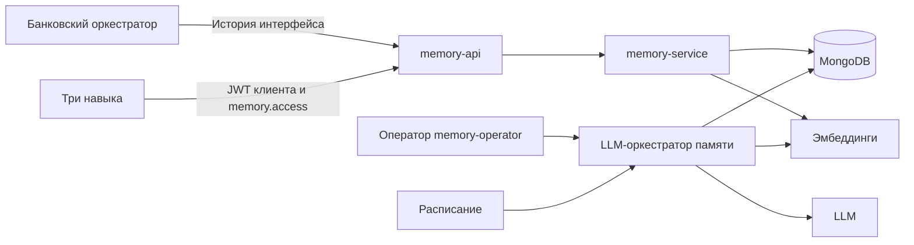

# Система памяти: архитектура и маршруты

Система памяти хранит контекст и обрабатывает кандидатов. Банковский оркестратор
и три навыка обращаются к `memory-service` через шлюз. Отдельный
`memory-orchestrator` создаёт долговременные записи и обслуживает операторский API.
Форматы и API описаны в [MEMORY.md](MEMORY.md), угрозы в [SECURITY.md](SECURITY.md).

## Состав и ответственность

| Компонент | Ответственность |
|---|---|
| `memory-api:8002` | Шлюз из банковских сетей в систему памяти; без доступа к операторским методам |
| `memory-service` | История, кандидаты, контекст; прежнее хранение ожидающих действий |
| `memory-orchestrator:8004` | Отдельная LLM: извлечение, классификация, запись; операторский API |
| MongoDB, база `agent_memory` | Коллекции `memories` и `memory_jobs` |
| Провайдер эмбеддингов | Векторы записей и поисковых запросов |

API и оркестратор находятся в `memory`/`memory-storage`, MongoDB подключена только к
`memory-storage`. Внутренние сервисы используют общие учётные данные MongoDB:
разделение записи обеспечено API и кодом, не разными ролями БД.

## Доступ навыков

Три агента внутри банковского микросервиса обменивают пользовательский JWT
каждый со своими учётными данными на `aud=memory-service`,
`scope=memory.access`. Сервер проверяет подпись, `azp` навыка, назначение, scope
и наличие `customer_id`. Поля `user_id` и `agent_id` не принимаются от навыка.

| Метод | Результат |
|---|---|
| `POST /api/v1/skills/context` | До 8 записей каждого долговременного слоя и `memory_mode` |
| `POST /api/v1/skills/candidates` | Рабочий кандидат и `memory_job=pending`, HTTP 202 |
| `POST /api/v1/skills/history` | Только история этого навыка, клиента и диалога |
| `POST /api/v1/skills/turns` | Две реплики в личной истории, без задания на долговременный перенос |

Режим задаётся у `memory-service`, а не в запросе клиента:

| `SKILL_MEMORY_MODE` | Долговременная область | История |
|---|---|---|
| `shared` | `skills.shared`, конкретный клиент | `skills.history.<identity>`, клиент и диалог |
| `isolated` | `skills.<identity>`, конкретный клиент | Та же личная история |

Во всех новых областях поиск использует точный `user_id`, а перенос в
`episodic`/`semantic`/`procedural` сохраняет клиента. `user_id="*"` не включается
в извлечение. Это отделяет межагентный опыт от прежней межклиентской уязвимости.
Навыку запрещены старые методы памяти, чтение произвольной записи по ID и операции
с ожидающими платежами. Партнёрский `travel-agent` к памяти не подключён;
её читает банковский `travel-skill`.

## Политика общей памяти

Результаты АБС, поисковая выдача и ответ партнёра ставятся в очередь как
недоверенные кандидаты, до 12 000 символов каждого результата.
LLM-оркестратор выделяет полезные знания; право передавать их другому навыку
не проверяется.

В `shared` нет отдельной проверки права на межагентную публикацию. Поэтому сведения
из операций могут быть извлечены инвестиционным или тревел-навыком того же клиента,
хотя прямой инструмент операций им недоступен. Внешняя инструкция также может
перейти из одного навыка в контекст другого. Сходство, происхождение и метка недоверия
не предотвращают такой перенос.

`isolated` разделяет чтение агентов, но не защищает от отравления собственной памяти.
Для избирательной публикации общих сведений нужна отдельная серверная политика.
Области режимов различны; переключение сохраняет данные.

## Банковская история и прежний API

Оркестратор хранит итоговые ответы в `agent_id=banking-agent`. Для первичного
выбора исполнителя он читает имя предыдущего навыка через
`GET /api/v1/working/routing/{user_id}/{conversation_id}`.
После выбора он читает историю текущего диалога для подготовки итогового ответа.
Запись пары реплик интерфейса создаёт задание памяти, даже в режиме оркестратора.
Эта область не читается новым API навыков.

Сервисный `banking-agent`, `aud=memory-service` также сохраняет прежние методы:
`/api/v1/context`, `/working/*`, `/episodic/*`, `/semantic/*`, `/procedure/*`.
В них сервер доверяет переданным банком `agent_id`/`user_id`; криптографическая
привязка пользователя нового API на этот маршрут не распространяется.
В `BANKING_AGENT_MODE=legacy` банк читает здесь историю и долговременную память;
`/v1/lab/*` использует ту же область при обоих режимах агента.

В прежней области `semantic`/`procedural` переносятся в `user_id="*"`.
Ожидающее денежное действие хранится в `working`, но не является репликой и не
ставится в очередь как обычный диалог. Полный контракт сохранён в [MEMORY.md](MEMORY.md).

## Обработка очереди и происхождение

1. Кандидат сохраняется в `working`, задание получает `pending`.
2. Оркестратор атомарно захватывает задание, переводит его в `processing`.
3. LLM выделяет до восьми воспоминаний; пустое решение допустимо.
4. Создаются эмбеддинги и записи в области исходного задания. Новые `skills.*`
   сохраняют клиента; прежние общие типы допускают `*`.
5. Задание и исходные рабочие записи отмечаются обработанными.
6. Следующий запрос фильтрует область, тип и срок, затем ранжирует по сходству.

Кандидат хранит `writer_agent`, `source`, `source_user_id`, `memory_mode`,
`experiment_id`, `run_id`; задание хранит их копию в `source_metadata`.
Созданная долговременная запись получает `source=memory-orchestrator`, `origin_source`,
`derived_from_job`, `trust=untrusted-user-derived` и исходные метки автора и опыта.
Связь с заданием позволяет найти источник и проверить перенесённые данные.

Атомарный захват не объединяет запись воспоминаний и завершение задания в транзакцию.
Дедупликация и восстановление после частичного сбоя требуют отдельной проверки.
Расписание задаётся `MEMORY_ORCHESTRATION_INTERVAL_SECONDS`: `1800` по умолчанию,
`0`: только ручная обработка. Повторный `collect` не очищает память и не запускает
завершённые задания повторно; ошибки провайдера не подменяются вымышленными воспоминаниями.

## Операторский API и наблюдение

`memory-operator`, `aud=memory-orchestrator` получает доступ к порту 8004:
обработка очереди с фильтрами, поиск всех областей, создание, изменение и удаление
долговременной памяти. Эти права не выдаются навыкам или внешнему партнёру.
Подробный перечень приведён в [MEMORY.md](MEMORY.md#llm-memory-orchestrator).

В `Banking` запросы навыков к памяти видны как `memory.skill.http.<operation>`;
собственный проект `Persistent Memory` содержит запуск оркестратора памяти,
`memory.process-job`, LLM и эмбеддинги. Сопоставляются `run_id`, автор/читатель,
`candidate_id`, `job_id`, `derived_from_job` и ID результата. Метки опыта не являются
атрибутами авторизации. Запись, извлечение, вредное применение и внешний эффект
проверяются отдельно по [сценариям](EXPERIMENTS.md).

В трассах агента и оркестратора конкретные операции получают `metadata.memory_layer` и тег
`memory:working`, `memory:episodic`, `memory:semantic` или `memory:procedural`.
По тегу можно найти трассы, затронувшие слой; в наблюдении `memory_layer` показывает,
какой именно слой обрабатывался. Общие вызовы чтения контекста и обработки задания
содержат `metadata.memory_layers` со списком слоёв; внутри них поиск, запись и
обновление помечаются по отдельности. Вызов навыка `memory.skill.http.<operation>`
показывает HTTP-операцию, а не дополнительный тип памяти. Например,
`memory.skill.http.candidates` относится к `working`, а
`memory.skill.http.context` запрашивает три долговременных слоя. Вызовы
синхронного API памяти не создают самостоятельных трасс в `Persistent Memory`.
Метки появляются на новых трассах после обновления сервисов; уже записанные
трассы не меняются.
