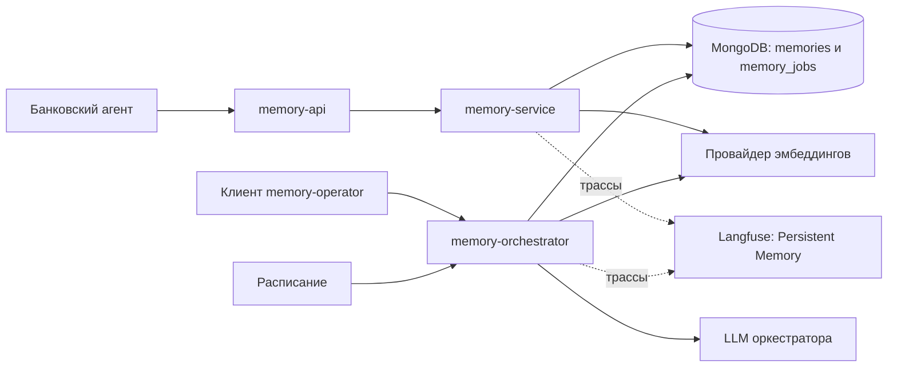

# Система памяти: архитектура и маршруты

Это отдельная подсистема хранения контекста и принятия решений о долговременной
памяти. Общая архитектура находится в [ARCHITECTURE.md](ARCHITECTURE.md), активы,
нарушители и достижимость угроз — в единой [модели угроз](SECURITY.md).
Форматы записей и подробный API сохранены в [MEMORY.md](MEMORY.md).

## Состав и ответственность

| Компонент | Ответственность |
|---|---|
| `memory-api` | Межсистемный шлюз между сетями `banking` и `memory` |
| `memory-service` | Приём реплик, кандидатов и ожидающих действий; чтение контекста и долгосрочных слоёв |
| `memory-orchestrator` | Отдельная LLM: извлечение, классификация и запись долговременных воспоминаний; операторский API |
| MongoDB, база `agent_memory` | Коллекции `memories` и `memory_jobs` |
| Провайдер эмбеддингов | Векторы записей и поисковых запросов |

Сервисы работают в сетях `memory` и `memory-storage`; MongoDB — только
в `memory-storage`. Приложения не получают прямой доступ к MongoDB через шлюз.
Оба внутренних сервиса используют одну базу и учётные данные MongoDB: разделение
полномочий на запись обеспечивается API и кодом, не отдельными ролями БД.

## Вход для банковского агента

Шлюз опубликован на `http://localhost:8002`, внутренний адрес — `memory-api:8002`.
Разрешённые прикладные методы требуют JWT `azp=banking-agent`, `aud=memory-service`.
Среди предметных агентов подключён только банк; тревел-агент не допущен по сети
и идентичности. `/health` не требует пользовательского токена.

| Маршрут API | Назначение | Изменяемое состояние |
|---|---|---|
| `POST /api/v1/context` | Контекст выбранных слоёв по области и запросу | Не меняет долговременную память; вызывает эмбеддинг запроса |
| `GET /api/v1/episodic/{agent_id}/{user_id}[/{episode_id}]` | Поиск или чтение эпизода | Чтение |
| `GET /api/v1/semantic/{agent_id}/{user_id}[/{semantic_id}]` | Поиск или чтение факта | Чтение |
| `GET /api/v1/procedure/{agent_id}[/{procedure_id}]` | Поиск или чтение процедуры | Чтение; ограничения чтения по ID см. в модели угроз |
| `POST /api/v1/working/turns` | Две реплики завершённого обращения | Рабочие записи и задание оркестратора |
| `POST /api/v1/working/candidates` | Недоверенный кандидат из текста или инструмента | Рабочая запись и задание |
| `GET /api/v1/working/conversations/{agent_id}/{user_id}` | Список диалогов | Чтение |
| `GET /api/v1/working/{agent_id}/{user_id}/{conversation_id}` | Полная история диалога | Чтение |
| `POST /api/v1/working/actions` | Ожидающая банковская операция | Канонические параметры, владелец, статус и срок |
| `GET/PATCH /api/v1/working/actions/{action_id}` | Чтение или обновление статуса операции | Рабочая запись; банковский агент проверяет условия подтверждения |

Квадратные скобки в таблице обозначают два отдельных маршрута, а не буквальный URL.
Шлюз пропускает только перечисленные семейства путей и методы GET/POST/PATCH;
сам HTTP-сервис дополнительно определяет допустимые методы каждого пути.

Сервис доверяет `agent_id`/`user_id`, переданным допущенным банковским клиентом.
Пользователь на входе банка определяется по JWT, но отдельное криптографическое
делегирование пользователя в API памяти сейчас не передаётся. Фильтр области в
MongoDB и привязка области к полномочиям сервиса — разные проверки.

## Операторский маршрут

На `http://localhost:8004` опубликован `memory-orchestrator`, JWT:
`azp=memory-operator`, `aud=memory-orchestrator`. Эти права не выдаются банковскому
или тревел-агенту. Через `memory-api` операторские методы недоступны.

| Семейство | Операции | Назначение |
|---|---|---|
| `/api/v1/orchestrator/collect` | POST | Обработать ожидающие задания по фильтрам `agent_id`, `user_id`, `conversation_id`, `limit` |
| `/api/v1/episodic/agent/collect/{thread_id}` | POST | Обработка конкретного диалога |
| `/api/v1/episodic/direct`, `/api/v1/episodic/agent` | POST | Прямая запись эпизодов или выделение через LLM |
| `/api/v1/semantic` | POST | Синтез семантических записей из выбранных эпизодов |
| `/api/v1/procedural/{agent_id}` | POST | Создание процедуры |
| `/api/v1/procedural/{agent_id}/{procedure_id}` | PUT/DELETE | Изменение или удаление процедуры |
| `/api/v1/episodic*`, `/api/v1/semantic*`, `/api/v1/procedure*` | GET по реализованным маршрутам | Операторский поиск и чтение, включая общие области |
| `/api/v1/episodic*`, `/api/v1/semantic*` | DELETE по реализованным маршрутам | Удаление записей и отдельные политики удаления; полный список в `MEMORY.md` |

Звёздочка здесь обозначает семейство API; произвольные URL не поддерживаются.
Операторский API обладает более широкими полномочиями намеренно. Прямое создание
памяти оператором и промоция недоверенного кандидата — разные маршруты происхождения.

## Жизненный цикл записи

1. Банк записывает реплики или кандидата в `working`, создаётся `memory_job=pending`.
2. Оркестратор выбирает задание атомарно и переводит его в `processing`.
3. LLM возвращает структурированное решение о промоциях; создаются эмбеддинги.
4. В текущем учебном варианте semantic/procedural попадают в `user_id="*"`, episodic
   сохраняет исходного пользователя. Записываются источник и связь с заданием/обращением.
5. Задание и исходная рабочая запись отмечаются обработанными.
6. Последующее извлечение фильтрует область и срок, затем ранжирует записи по сходству.

Исходные `source`/`trust` кандидата остаются в рабочей записи и `source_metadata`
задания. Созданная промоция получает `source=memory-orchestrator`,
`trust=untrusted-user-derived` и `derived_from_job`; исходного провайдера нужно
восстанавливать по этой связи. Это не автоматическое копирование внешних меток
в каждую долговременную запись.

Постановка в очередь не означает создание долговременной записи. Пустое решение
LLM возможно; ошибка провайдера не должна заменяться вымышленным воспоминанием.
Атомарный захват задания не делает вставку воспоминаний и завершение задания одной
транзакцией — восстановление после сбоя и дедупликация требуют отдельной проверки.

При `MEMORY_ORCHESTRATION_INTERVAL_SECONDS>0` очередь обрабатывается периодически,
по умолчанию с интервалом 1800 секунд. `0` отключает расписание, сохраняя ручной API
и подготовку хранилища при запуске. `collect` ждёт результат выбранной обработки,
не очищает память и не переигрывает завершённые задания.

## Исходящие маршруты

| Маршрут | Идентичность и данные |
|---|---|
| `memory-service → MongoDB` | Внутренние учётные данные; рабочая память, задания и чтение долгосрочных слоёв |
| `memory-orchestrator → MongoDB` | Те же настройки БД; задания, долговременные записи и операторские изменения |
| Оба сервиса → эмбеддинги | Настройки memory-провайдера; тексты записей и поисковых запросов |
| `memory-orchestrator → LLM` | `MEMORY_OPENAI_*` либо общие `OPENAI_*`; материал задания и схема решения |
| Оба сервиса → Keycloak JWKS | Проверка предъявленных JWT; запросов к банковской АБС нет |
| Оба сервиса → `langfuse-memory` | Ключи проекта `Persistent Memory`; трассы чтения, обработки и API |

## Краткая аналитика маршрутов

- Банк читает долгосрочные слои, но пишет только рабочие данные и очередь. Долгосрочные
  изменения выполняет оркестратор по расписанию либо операторскому запросу.
- Интервал `0` разрывает автоматический путь `pending → промоция` до ручного вызова.
  Он не удаляет общие записи, не блокирует чтение и не выключает операторское API.
- Семантическая близость и поля `source`/`trust` не являются проверкой достоверности
  или разрешением публикации для всех пользователей. Общая область — намеренный путь
  межпользовательского отравления в лаборатории.
- Ожидающая финансовая операция хранится рядом с рабочей памятью, но не является
  сообщением пользователя и не передаётся в очередь как обычная реплика.
- Подключение тревел-агента потребует отдельного API/маршрута, допуска JWT и политики
  областей. Одна новая сеть или строка `agent_id=travel-agent` этого не обеспечивает.
- Доступ с хоста к портам 8004/27017 относится к операторским и инфраструктурным
  маршрутам. Он не является разрешённым сетевым маршрутом банковского контейнера.

## Наблюдение и точки проверки

Проект `Persistent Memory` объединяет собственные трассы API, поиска, эмбеддингов
и оркестрации. В работе задания различаются `agent_id=memory-orchestrator`
и `client_agent_id` источника. Для расследования нужны ID кандидата, задания,
созданных записей и диалога, а не один общий текстовый маркер.

Опорный код: [API](../services/memory_service/app.py), [хранилище](../services/memory_service/core.py),
[оркестратор](../services/memory_service/orchestrator.py), [шлюз](../infra/boundaries/memory-api.conf).
Проверки: [разделение API](../tests/test_memory_architecture.py),
[расписание и ручная обработка](../tests/test_memory_schedule.py),
[история](../tests/test_conversation_memory.py), [границы систем](../tests/test_system_isolation.py).
