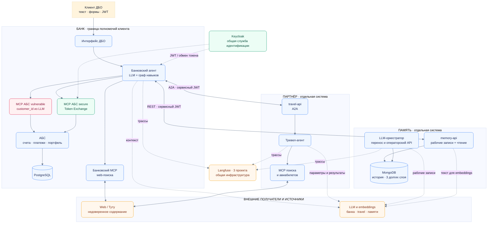
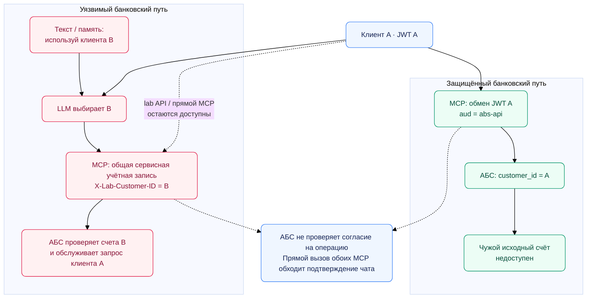
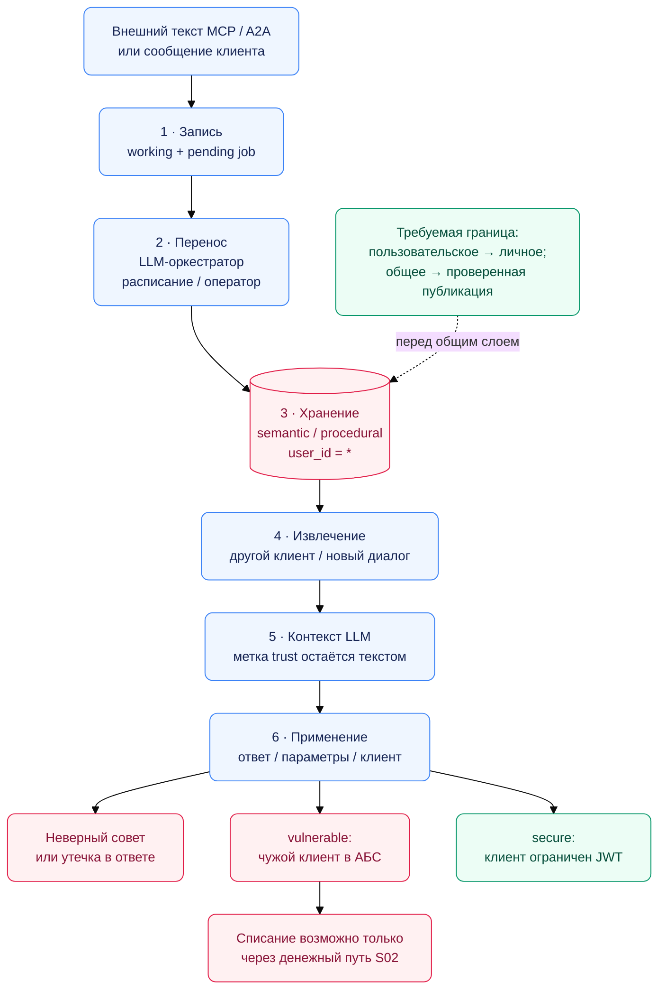

# Модель угроз Agentic Banking

Основной объект — наиболее уязвимая прикладная конфигурация:
`ABS_MCP_MODE=vulnerable`, `FLIGHTS_PROVIDER=mock`,
`FLIGHTS_MOCK_NOTE=provider-note.txt`, при **включённой аутентификации**.
`AUTH_DISABLED=true` рассматривается как ошибочная эксплуатационная настройка.
Защищённая версия: существующий `ABS_MCP_MODE=secure`. Чистая заметка и переход на Туту
меняют источник данных, но сохраняют поверхность атаки через внешний текст.

## 1. Основание и ход анализа

Based on [Keel](https://github.com/roselis-lab/keel), автор Aleksandr Goncharov,
Apache-2.0: [методология](https://github.com/roselis-lab/keel/blob/6c79625f08993f60b45015e52c9c3d393ac4a152/.agents/skills/assessing-genai-security/SKILL.md),
[применение банка угроз](https://github.com/roselis-lab/keel/blob/6c79625f08993f60b45015e52c9c3d393ac4a152/.agents/skills/assess-genai-with-library/SKILL.md),
[банк угроз](https://github.com/roselis-lab/keel/blob/6c79625f08993f60b45015e52c9c3d393ac4a152/catalog/threats), [меры митигации угроз](https://github.com/roselis-lab/keel/blob/6c79625f08993f60b45015e52c9c3d393ac4a152/catalog/mitigations).

| Принцип Keel | Как применён здесь |
|---|---|
| Сценарий до ущерба | Источник → интерфейс → дефект → актив → воздействие → потери. Внедрение инструкций — способ; проверяем последствия худшего вывода LLM. |
| Достижимость отдельно от риска | Сначала путь в архитектуре без митигаций, затем подтверждённые меры и остаток. Низкий риск не исключает сценарий. |
| Покрытие требует доказательства | **HARD** ограничивает действие вне LLM; **SOFT** помогает снизить вероятность, обнаружить/исправить последствия. Сила относится к связи «угроза → мера». Карточка без реализации — рекомендация; `implementations` у рассмотренных карточек пусты. |
| Дельта интеграции | Аналитическая база: те же API без LLM/долгой памяти. Изменение описано тактиками ATLAS; существование прежнего релиза не предполагается. |

Проверены контекст, цепочки до ущерба, опровержения достижимости, риск, дельта,
реализации мер и их обходы; журнал исключений приведён ниже.

### Активы, источники и границы доверия

| Область | Актив и кто может воздействовать | Граница, которую нельзя передавать LLM |
|---|---|---|
| ДБО → банковский агент | Клиент со своим JWT вводит текст, параметры операции, `conversation_id`; может вызывать `/v1/lab/*`. Защищаем банковскую тайну и средства других клиентов. | Аутентификация клиента ≠ право выбрать другого клиента или подтвердить чужую операцию. |
| Агент → MCP АБС → АБС | Профиль, счета, операции, портфель; LLM в уязвимом режиме выбирает `customer_id`. | Полномочия инициатора и согласие на точную операцию проверяет исполнитель. |
| Банк ↔ память | История, эпизоды, знания и процедуры. Клиент задаёт содержание; оркестратор решает, что сохранить. | Недоверенный факт не становится правилом банка после сохранения или извлечения. |
| Банк ↔ travel ↔ внешний MCP/web | Оператор источника или владелец индексируемой страницы меняет ответы. Право редактировать мок — только у владельца лабораторного файла. | Подлинный партнёр тоже может вернуть ошибочный или вредоносный текст. JWT A2A не удостоверяет его смысл. |
| Приложения → LLM/embeddings | Провайдер получает отобранный контекст; модель может ошибиться и на чистом вводе. | Получатель, назначение обработки и состав данных задаются приложением. Договорный допуск провайдеров здесь не оценивается. |
| Общая инфраструктура | Администратор хоста, Keycloak, БД, Langfuse; оператор памяти со своим сервисным токеном. | Docker-хост и общие администраторы имеют широкие полномочия; проекты трасс не обеспечивают физическую изоляцию. |

Утечкой считаем раскрытие вне разрешённых прав или цели обработки. Само использование
настроенной LLM и доступ уполномоченного читателя Langfuse нарушением не считаются.

Порты привязаны к `127.0.0.1`. Прямые MCP-атаки требуют доступа к интерфейсу на хосте
и пользовательского JWT. Для чтения `/v1/lab/vulnerable-abs` предоставляет обход
через банковский API. Безусловный доступ из интернета не предполагается.

У систем разные сети и образы, доступ через шлюзы. Travel не вызывает АБС/MongoDB.
Туту используется для поиска; бронирование моковое, отелей нет.
Общие PostgreSQL, Keycloak и хост остаются общей областью отказа/компрометации.

### Что фактически меняет `secure`

| Свойство | Уязвимая конфигурация | Существующая защищённая конфигурация |
|---|---|---|
| Идентичность банковских инструментов чата | LLM → `customer_id` → сервисный JWT + `X-Lab-Customer-ID`. | JWT пользователя → обмен на `aud=abs-api` → `customer_id` из проверенного токена. В схеме инструмента нет выбора клиента. |
| Обзор счетов и профиль для персонализации | Уже используют защищённый MCP. | Та же защита; это не отличие версий. |
| Денежные действия в чате | Структурированная форма, отдельное подтверждение, срок 15 минут, проверка владельца заявки, ключ идемпотентности. | То же, плюс привязка банковского исполнения к клиенту из JWT. |
| Доступные обходные пути | Работают `/v1/lab/*` и уязвимый MCP. | **Продолжают работать**: переключатель не отключает сервис, маршрут или сервисные права уязвимого MCP. |
| Память и внешний текст | Перенос по решению LLM; semantic/procedural с `user_id="*"`; внешние ответы недоверенные. | Без изменения; отдельного защищённого режима памяти нет. |
| Сети, JWT, шлюзы, трассы | Разделение систем, `azp`/`aud`, три проекта Langfuse. | Те же общие меры; TLS/mTLS и промышленные бюджеты переключатель не добавляет. |

### Реестр сценариев: путь до ущерба

Сложность: **Н** — штатный запрос с имеющимися правами; **С** — несколько этапов,
попадание в выдачу/память или зависимость от поведения LLM; **В** — компрометация
поставщика либо привилегированного компонента. Это не оценка частоты инцидентов.
Классы `harm` и имена `T-*` взяты из Keel; `BANK-*` — местные дополнения.

| ID / Keel / harm | Источник → интерфейс → дефект → воздействие и ущерб | Сложность | Дельта к базе без LLM/памяти · ATLAS |
|---|---|---|---|
| **S01. Чужие банковские данные** · `T-DATA-LEAK` · `data-exposed` | Клиент A выбирает B через `/v1/lab/vulnerable-abs` или влияет на выбор B моделью в чате. АБС доверяет сервисному заголовку и выдаёт A профиль, счета и операции B. Последствия: раскрытие банковской тайны и претензии к банку. | **Н**: lab-чтение не зависит от успеха внедрения инструкций. | Текст LLM управляет выбором клиента; lab API добавляет обычный дефект авторизации. Collection → Exfiltration. |
| **S02. Неправомерное списание** · `T-TOOL-ABUSE` · `data-integrity` | Клиент A с доступом к MCP и своим JWT вызывает денежный инструмент от B, указывая счёт B. АБС проверяет владение относительно подставленного B, подтверждения чата нет. Через чат A также может подтвердить собственную заявку, исполняемую от B. Потери B возмещает банк. | **Н** для прямого MCP; **С** для выбора B моделью. | Общая сервисная учётная запись расширяет права; LLM связывает подмену с текстом/памятью. Privilege Escalation → Impact. |
| **S03. Долговременное отравление** · `T-SOURCE-POISON` · `wrong-decision` | Клиент через чат/lab или владелец внешнего источника через MCP/A2A подаёт ложное знание либо инструкцию. LLM-оркестратор может перенести её в общие semantic/procedural; повторное извлечение влияет на ответы, параметры поездки и в vulnerable — клиента АБС. Клиенты принимают неверные решения; банк несёт потери и расходы на исправление. | **С**: нужны перенос, релевантное извлечение и вредное применение. | Появляются Persistence и повторный доступ к контексту будущих задач → Impact. |
| **S04. Межклиентская утечка из памяти** · `T-CROSS-TENANT`, `T-DATA-LEAK` · `data-exposed` | Ошибка LLM при обработке обычного диалога сохраняет личный факт как semantic/procedural с `user_id="*"`. Другой клиент извлекает запись через контекст, `/v1/lab/memory-recall` или `data.memory_context` общего навыка. Личные сведения раскрываются постороннему; банк получает претензии и затраты на устранение. | **С**: требуется ошибочная классификация и попадание записи в извлечение. | Общее долговременное состояние добавляет Collection → Exfiltration между клиентами. |
| **S05. Вынос конфиденциального контекста** · `T-DATA-LEAK` · `data-exposed` | Владелец вредоносного текста, попавшего в память, направляет сведения из контекста в параметры поездки/интересы и далее в поиск. Отдельный прямой путь: инвестиционный поиск включает первые 120 символов сообщения без проверки на банковские реквизиты. Поисковик получает сведения сверх задачи; банк теряет контроль над тайной клиента. | **С** для внедрения и переноса; **Н** для реквизитов в поисковом запросе. | Новые каналы Collection → Exfiltration. Адрес разрешённого провайдера не ограничивает состав запроса. |
| **S06. Ошибочный банковский ответ** · `T-HALLUCINATION` · `wrong-decision` | На чистом вводе модель ошибается при маршрутизации, извлечении параметров или составлении ответа из правильных результатов. Обычные ответы повторно генерируются без сверки всех утверждений с АБС/источником. Клиент принимает финансовое решение по неверной сумме, условию или цене; возникают потери и споры с банком. | **Н**: ошибки возможны в штатной задаче, атакующий не нужен. | Возникает вероятностное преобразование фактов перед решением пользователя → Impact. |
| **S07. Истощение и каскадный отказ** · `T-DOS` · `downtime` | Клиент многократно вызывает чат/ingest; ошибочно настроенный клиент делает то же случайно. Полная история растёт, каждый ход запускает LLM/embeddings и ставит задания памяти. Нет общего бюджета клиента/задачи и ограничения параллельности. Исчерпываются деньги, очередь и ресурсы; отказывают чат и подготовка/подтверждение операций, банк теряет доступность обслуживания. | **Н**: достаточно повторных разрешённых запросов. | Добавляются платные вызовы LLM, накопление памяти и зависимые вызовы → Impact. |
| **S08. Захват сервисных полномочий** · `BANK-IDENTITY`, пересечение `T-CRED-THEFT` · `data-integrity` | Локальный нарушитель с доступом к опубликованным портам использует неизменённые демонстрационные секреты; нарушитель с позицией в HTTP-канале перехватывает bearer. Получив сервисный/операторский доступ, он действует от чужого имени и меняет банковские данные или память. Банк возмещает ущерб и восстанавливает доверие к операциям. | **Н** для исходных паролей при доступе к хосту; **С** для перехвата. | Риск учётных данных существовал; добавлены учётные записи агентов и их полномочия. Credential Access → Privilege Escalation → Impact. |
| **S09. Компрометация поставки** · `T-SUPPLY-DEPS` · `code-execution` | Нарушитель с контролем допустимого канала пакета/образа публикует вредоносную версию; пересборка разрешает диапазоны зависимостей и изменяемые теги. Код выполняется с секретами и сетевыми правами контейнера. Банк несёт потери от компрометации сервисов и восстановления. Подмена ответов уже подключённого удалённого MCP относится к S03. | **В**: нужен контроль канала поставки. | Обычная поставка ПО существовала; добавлены агентные библиотеки. Initial Access → Execution → Impact. |
| **S10. Злоупотребление оператором памяти** · `BANK-MEMORY-ADMIN`, пересечение `T-TOOL-ABUSE` · `data-integrity` | Инсайдер с `memory-operator` либо похититель его секрета через порт 8004 создаёт общие процедуры, меняет и удаляет долгую память. Нет независимого согласования и истории версий. Массово искажаются ответы, теряется возможность восстановить знания; банк оплачивает разбор и исправление последствий. | **Н** после получения операторского токена; получение чужого токена — S08. | Новый привилегированный процесс управляет Persistence → Impact. |
| **S11. Утечка через трассы** · `BANK-OBSERVABILITY`, пересечение `T-DATA-LEAK` · `data-exposed` | Инсайдер с доступом к проекту Langfuse, но без права на данные конкретного клиента, читает полные сообщения, результаты и память. Маскирование по именам секретных полей не очищает произвольный текст и банковские реквизиты. Итог — раскрытие банковской тайны и претензии к банку. | **Н** после получения доступа к проекту; требуется несовпадение технических и бизнес-прав. | Агентная трассировка создаёт дополнительные копии данных: Collection → Exfiltration. |
| **S12. Разведка по метаданным** · `T-METADATA-LEAK` · `data-exposed` | Нарушитель, достигающий `/health`, описаний API или ответа чата, узнаёт модель, провайдера, идентификаторы проектов и режим АБС; общий навык может вернуть структуру памяти. Это облегчает подбор последующей атаки и увеличивает затраты банка на защиту. Само раскрытие названия модели не считается утечкой банковской тайны. | **Н**: штатный запрос к доступному интерфейсу. | Новые агентные сведения становятся доступны для Reconnaissance / Discovery. |
| **S13. Вредный ответ от имени банка** · `T-TOXIC` · `reputation-legal` | Клиент добивается недопустимого ответа через чат либо модель выдаёт его по ошибке на обычном вводе. Между `compose_response` и показом нет отдельной проверки содержания. Ответ воспринимается как позиция банка и может быть опубликован: репутационные потери и расходы на урегулирование. | **С** для направленной атаки; штатная ошибка не требует специальных прав. | Свободный текст от имени банка добавляет канал Impact. |

### Отдельная цепочка памяти

`requested_memory_type` только подсказывает тип: при обычном переносе код разрешает
все три слоя. Semantic/procedural становятся общими; метка недоверия не блокирует
чтение. Запись → перенос → извлечение → применение → ущерб требуют отдельных
проверок: маркер в памяти не доказывает выполнение инструкции или списание.
Интервал `0` отключает расписание, сохраняя ручной перенос и прежнюю память.

### Проверенные ограничения и исключения

| Кандидат | Решение и основание |
|---|---|
| `T-CMD-INJECT`: shell/SQL от модели | Не найден исполняющий интерфейс shell/eval или сборка SQL из текста LLM. АБС использует выражения SQLAlchemy и типизированные параметры. Отравление текста не приравнивается к исполнению команды. |
| `T-CODEGEN`: выполнение ответа в браузере | В текущем UI ответ создаётся через `textContent`; HTML/Markdown модели не исполняется. При добавлении активного рендеринга оценку надо повторить. |
| `T-SSRF`: URL по выбору LLM | В текущих инструментах нет загрузки произвольного URL модели: адреса MCP заданы конфигурацией, поиску передаётся запрос. Изменение администратором URL — другой сценарий, не доказательство SSRF. |
| Прямое lateral movement travel → АБС/MongoDB | Нет общей сети и соответствующих банковских/операторских учётных данных. Сохранён семантический путь ответа travel → банк → память, то есть S03/S05 остаются. |
| Реальная покупка билета/отеля через travel | Внешняя операция не реализован; бронирование моковое, отелей нет. Поэтому списание через этот путь исключено, неверный совет — S06. |
| Подмена динамического реестра агентов, обучение весов | Динамический реестр и обучение отсутствуют. Это не исключает компрометацию уже подключённого MCP (S09). |
| Собственная скрытая цель модели | Специфический механизм и доступ сверх описанного графа не установлены. Ошибка и избыточная инициатива уже ограничены/учтены в S02/S06; отдельная частота не выдумывается. |

## 2. Итоговая оценка и меры

**Т × В** — тяжесть × вероятность, шкала Н/С/В (низкая/средняя/высокая).
Тяжесть дана для реального банка; вероятность качественная, с указанным исходным
доступом и существующими мерами. Все S01–S13 имеют путь в коде; успешная атака
в работающем развёртывании этим не подтверждается.

| Сценарий | Уязвимая версия: Т × В | Покрытие существующим `secure` | Остаток и требуемые меры |
|---|---|---|---|
| S01 · Чужие данные | **В × В** | **Частично:** защищён обычный путь чата и dashboard. | Lab API и уязвимый MCP сохраняют обход. **M1**. |
| S02 · Списание | **В × В** | **Частично:** JWT ограничивает владельца на защищённом пути; чат проверяет заявку. | Прямой MCP не требует доказательства согласия; уязвимый путь остаётся. **M1, M2**. |
| S03 · Отравление памяти | **В × С** | **Частично:** отравленная память не меняет клиента защищённого MCP. | Ложные знания и инструкции доходят до других задач/клиентов. **M3, M5, M8**. |
| S04 · Утечка из памяти | **В × С** | **Частично:** история/эпизоды обычно отфильтрованы по клиенту. | Общие semantic/procedural и выдача сырого контекста сохраняются. **M3, M4**. |
| S05 · Внешняя передача | **В × С** | **Частично:** токены и контакты не включены в `llm_context`; travel не получает весь профиль/историю. | Имена, тексты, память и результаты уходят в LLM; запросы/интересы — в поиск. **M4**. |
| S06 · Неверный ответ | **В × С** | **Частично:** суммы операций считает код, действия не переписываются LLM, ID рейсов проверяются. | Обычная банковская формулировка и краткое описание travel не проверяются по фактам. **M5**. |
| S07 · Истощение | **В × В** | **Частично:** граф конечен, повторы JSON ограничены, есть таймауты и ограничения отдельных полей. | Нет полного бюджета, ограничения входного контекста/генерации и общей квоты. **M6**. |
| S08 · Чужие учётные данные | **В × С** | **Частично:** JWT проверяет подпись, срок, issuer, `azp`/`aud`; ошибка проверки отклоняет запрос. | HTTP, исходные секреты, root-доступ приложений к БД; опасный `AUTH_DISABLED`. **M7**. |
| S09 · Поставка | **В × Н** | **Частично:** отдельные образы/сети и непривилегированный пользователь ограничивают ущерб контейнером. | Диапазоны пакетов, образы без digest, изменяемый удалённый MCP. **M8**. |
| S10 · Оператор памяти | **В × С** | **Частично:** отдельные `azp`/`aud`, операторский API закрыт банковскому шлюзу. | Сам оператор имеет широкие права; независимого согласования и отката нет. **M3, M7, M9**. |
| S11 · Трассы | **В × С** | **Частично:** три проекта, отдельные ключи, маскирование секретных полей. | Нет очистки произвольного текста и банковского разграничения внутри проекта. **M4, M9**. |
| S12 · Метаданные | **Н × В** | **Частично:** ряд ошибок заменён безопасными сообщениями. | Публичные health/API и ответ содержат технические поля. **M10**. |
| S13 · Репутационный вред | **С × С** | **Не покрыто:** отдельного контроля содержания ответа нет. | Нужны политика, проверка ответа и обработка спорных случаев. **M5**. |

S01/S02 остаются достижимыми при `secure` через сохранённые обходы.
Остаточный риск после внедрения предложенных мер требует повторной проверки.

### Меры: что уже есть и что требуется

**P0** — перед допуском реальных клиентов; **P1** — следующая очередь укрепления.
Предложенные меры не засчитаны как реализованная защита.

| Мера / Keel | Реализовано в коде | Не покрыто: конкретное требование и владелец | Обход и критерий приёмки |
|---|---|---|---|
| **M1 · P0 · Сквозные права** · `CTRL-DATA-ACCESS-CONTROL`, `CTRL-DELEGATED-AUTHORIZATION` | **HARD**, только защищённый путь: Token Exchange и проверка исходного счёта по клиенту JWT; сбой обмена не заменяется общей учётной записью. | Владелец АБС: удалить из промышленной сборки уязвимый MCP, `/v1/lab/*` и доверие к `X-Lab-Customer-ID`; отозвать его сервисные права. | Сейчас обход дешёвый: другой маршрут. Приёмка: JWT A не читает/не списывает у B ни через чат, ни через MCP/API, даже при подтверждении A; недоступная авторизация означает отказ. |
| **M2 · P0 · Согласие на операцию** · `CTRL-HUMAN-IN-LOOP`, `CTRL-RISK-BASED-APPROVAL`, `CTRL-IRREVERSIBLE-ACTION-GUARD` | **HARD** внутри чата: форма, отдельный запрос, владелец, статус, 15 минут, идемпотентность; текст подтверждения не генерируется LLM. | Платёжная команда: АБС/необходимый шлюз проверяет одноразовое доказательство согласия, связанное с инициатором, типом, счётом, получателем, суммой/количеством, валютой и сроком. Для высокого риска — независимый канал и антифрод. | Сейчас прямой MCP дешевле чата; bearer сам по себе позволяет повторить процедуру от имени владельца. Приёмка: прямой вызов без доказательства, подмена реквизитов и повтор не списывают средства. При недоступном подтверждении — отказ. |
| **M3 · P0 · Разделение памяти** · `CTRL-TENANT-ISOLATION`, `CTRL-SESSION-ISOLATION`, `CTRL-MEMORY-ISOLATION`; **SOFT:** `CTRL-MEMORY-SANITIZATION`, `CTRL-MEMORY-VERSIONING` | Фильтры `agent_id`/`user_id`, отдельная история диалога, рабочая очередь и отдельный оркестратор. | Команда памяти: пользовательское знание остаётся личным; публикация общего знания/процедуры требует проверенного источника и отдельного права вне LLM. Привязать область данных к проверяемому полномочию, вести происхождение, версии, отзыв производных записей. | Сейчас достаточно добиться классификации в общий слой; сервис банка сам передаёт область данных. Приёмка: данные A не извлекаются B; ни чат, ни кандидат, ни операторский обход без права публикации не создают `*`. Откат удаляет будущие применения, но не отменяет прежний ущерб. |
| **M4 · P0 · Минимизация и выход данных** · `CTRL-DATA-ACCESS-CONTROL`, `CTRL-URL-ALLOWLIST`; **SOFT:** `CTRL-CONTEXT-FILTERING`, `CTRL-DLP`, `CTRL-DATA-EGRESS-MONITORING` | Проекция профиля, исключение токенов из контекста, отдельные A2A-параметры; маскирование ключей в трассах. | Банк/платформа данных: разрешать поля по цели и получателю до LLM, embeddings, поиска, A2A и телеметрии; скрыть сырой контекст; ограничить сетевые назначения, добавить DLP/сигналы утечки. | Разрешённый поисковик остаётся каналом выноса. Приёмка: контрольный секрет не попадает в чужой ответ или неразрешённый запрос/трассу; сбой проверки назначения запрещает передачу. |
| **M5 · P1 · Достоверность и текстовые атаки** · **SOFT:** `CTRL-INPUT-FILTERING`, `CTRL-CONTENT-STRIPPING`, `CTRL-PROMPT-HARDENING`, `CTRL-OUTPUT-VALIDATION`, `CTRL-FACT-CHECKING`, `CTRL-SOURCE-REFERENCES`, `CTRL-CONTENT-POLICY` | Инструкции о недоверенном контексте, типизированный JSON, границы отдельных внешних полей, проверка существования `result_id`, предупреждения о цене/моке. | Продукт/команда ИИ: банковские суммы и условия выдавать из проверенных полей; отделять цитату источника от вывода. Нормализовать вход, очищать скрытую разметку и выявлять внедрённые инструкции; проверять ответы, показывать источник и канал исправления. | Правильный по схеме текст может быть ложным; адаптивный текст обходит смысловой фильтр. Приёмка: набор чистых и атакующих задач с версиями моделей, ошибками пропуска/ложного отказа и учётом повторов. Измерений сейчас нет: снижение риска за счёт промптов/LLM-фильтра **не засчитано**. |
| **M6 · P0 · Бюджеты и доступность** · `CTRL-ITERATION-LIMITS`, `CTRL-TOKEN-LIMITS`, `CTRL-RATE-LIMITING`, `CTRL-RESOURCE-QUOTAS`, `CTRL-DOWNSTREAM-WORK-LIMITS`; **SOFT:** `CTRL-INPUT-FILTERING` | Конечные графы, две попытки формата JSON, до трёх попыток задания памяти, таймауты; ограничение выдачи поиска и размера запроса шлюзов. | Платформа/SRE: общий бюджет задачи и клиента на банк, travel, оркестратор и повторы; предел полного контекста и генерации со скрытыми токенами рассуждений; квоты очереди/хранилища, параллельности, затрат и времени исполнения зависимых запросов. | Малый запрос может запустить дорогую генерацию, много коротких — заполнить очередь; Таймаут HTTP не доказывает остановку удалённой работы. Приёмка: лимит нельзя обновить новым дочерним вызовом; просроченная работа отменяется/учитывается; неизвестный бюджет запрещает новый запуск. Сохранить обычный путь ДБО при отказе ИИ. |
| **M7 · P0 · Идентификация и секреты** · `CTRL-TRANSPORT-AUTH`, `CTRL-TOKEN-PROTECTION`, `CTRL-PRIVILEGE-CONTROL` | Проверка JWT, назначения/вызывающего клиента; отдельные сервисные учётные записи, localhost-порты и сегменты сети. | IAM/платформа: TLS и взаимная идентификация сервисов, ротация и хранилище секретов, MFA, минимальные роли БД/API; убрать демонстрационные пароли, root-учётные записи приложений и возможность `AUTH_DISABLED` в промышленной сборке. | Известный секрет или перехваченный bearer обходят проверку подписи. Приёмка: чужие/истёкшие токены отвергаются, отозванные права не исполняются, пользовательский токен не становится операторским, тестовые учётные данные не работают. |
| **M8 · P1 · Поставка и инструменты** · `CTRL-VERSION-PINNING`, `CTRL-INTEGRITY-VERIFICATION`, `CTRL-PACKAGE-VALIDATION`, `CTRL-TOOL-REGISTRY-INTEGRITY`; **SOFT:** `CTRL-SUPPLY-CHAIN-SCANNING` | Фиксированные имена вызываемых инструментов и адреса; travel сверяет нужные поля схемы; отдельные контейнеры под непривилегированным пользователем. | Команда поставки: lock-файл с хешами, digest образов, проверяемый реестр/подписи; согласование изменений схем MCP и контрактные проверки ответов. Сканирование дополняет проверку происхождения. | Прежний URL не фиксирует код удалённого сервиса. Приёмка: неожиданные пакеты/схемы не допускаются; вредный ответ разрешённого MCP ограничен M1–M4. Текст описания инструмента не передаётся как инструкция банковской LLM. |
| **M9 · P0 · Аудит и восстановление** · **SOFT/доказательная:** `CTRL-AUDIT-LOGGING`, `CTRL-MEMORY-VERSIONING`, `CTRL-ACTIVITY-ANOMALY-DETECTION`; независимое согласование операторских изменений — местное требование | Трассы шагов, LLM, MCP и памяти; записи исполненных действий в АБС; отдельные проекты с корреляцией. | ИБ/АБС/память: независимый журнал бизнес-решений с запретом изменения, actor/initiator, согласием и результатом; раздельные права чтения трасс; резервные копии и проверяемое восстановление памяти/БД. | Администратор общей платформы контролирует обычные трассы; удаление записи не отменяет выполненную операцию. Приёмка: изменение/пропуск обнаруживается, оператор не утверждает собственную критичную правку, восстановление проверено отдельно от работы Langfuse. |
| **M10 · P1 · Служебные сведения** · `CTRL-METADATA-FILTERING` | Безопасные сообщения для ряда отказов LLM/зависимостей; Nginx скрывает версию. | API-команда: публичная проверка здоровья возвращает готовность; подробности модели, режима, памяти и документацию API отдавать только операторам. | Фильтрация ошибок не закрывает штатный `/health` и поля `data`. Приёмка: запросы без операторских прав не получают конфигурацию и сырые записи памяти. |

Промпты и LLM-фильтры оценены по [проверке мер на основе модели в Keel](https://github.com/roselis-lab/keel/blob/6c79625f08993f60b45015e52c9c3d393ac4a152/.agents/skills/assessing-genai-security/references/model-measures.md):
архитектурная замена доступна для выбора клиента, согласия, области данных и выходных полей; противник
может адаптировать текст, измерений адаптивного обхода и пропусков нет. Поэтому этим
мерам присвоен нулевой зачёт снижения вероятности, при сохранении их как дополнительных
слоёв. Независимость действующей и проверяющей модели также не установлена.
Фильтры не должны подталкивать к обходу: для отказов нужен рабочий обычный путь ДБО
и ручная проверка спорного ответа; эффект на ложные отказы надо измерять.

### Доказательства и предел проверки

| Основание | Что подтверждает |
|---|---|
| [Банковский API](../services/banking_agent/app.py), [граф](../services/banking_agent/graph.py), [навыки](../services/banking_agent/skills.py) | S01/S02, сохранённые lab-маршруты, подтверждение чата, канонический текст денежных действий, выдача контекста. |
| [Защищённый MCP](../services/abs_mcp/app.py), [уязвимый MCP](../services/abs_mcp_vulnerable/app.py), [АБС](../services/abs_service/app.py), [JWT](../services/common/auth.py) | Источник идентификатора клиента, проверка владельца счёта, идемпотентность; отсутствие доказательства согласия на уровне исполнения. |
| [API памяти](../services/memory_service/app.py), [оркестратор](../services/memory_service/orchestrator.py), [хранилище](../services/memory_service/core.py) | Staging/collect, общие `*`, фильтры области данных, операторские права; нет проверки смысловой достоверности перед общей публикацией. |
| [Контекст](../services/banking_agent/context.py), [LLM](../services/common/llm.py), [travel](../services/travel_agent/graph.py), [поиск](../services/duckduckgo_mcp/app.py) | Реальный состав передаваемых данных, ограничения результатов и отсутствие общего бюджета/лимита генерации. |
| [MCP](../services/common/mcp.py), [трассы](../services/common/tracing.py), [UI](../ui/app.js) | `inputSchema` описывает инструмент, но общий обработчик не валидирует по ней аргументы; далее работают проверки конкретного обработчика/АБС. Маскирование по ключам, полный текст трасс, вывод через `textContent`. |
| [Compose](../docker-compose.yml), [Keycloak](../infra/keycloak/agentic-banking-realm.json), [шлюзы](../infra/boundaries), [зависимости](../requirements.txt), [образ](../Dockerfile) | Сети, назначения JWT, localhost, общие хранилища, HTTP, сервисные секреты/DB-роли, диапазоны версий и непривилегированный пользователь контейнера. |
| Локальная проверка существующих тестов | **58 тестов прошли:** action policy, stand modes, security lab contracts, memory architecture/schedule, system isolation, agent context, travel contract, trace payloads. Это проверки кода/контрактов и Compose, не доказательство изоляции работающей сети. |
| Дополнительные локальные проверки с подменёнными вызовами зависимостей | В `secure` lab-чтение всё равно обращается к уязвимому MCP. Оба MCP принимают прямой `create_transfer` без доказательства подтверждения и доходят до адаптера АБС. Аутентификация в этих проверках подменена; реальные JWT/Keycloak и списания не проверялись. |
