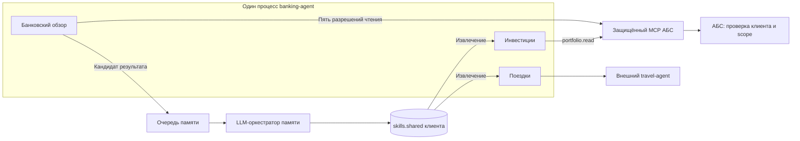

# Модель угроз Agentic Banking

Оценка относится к учебному стенду и его интерфейсам. Последствия описаны для
банковской системы с реальными клиентскими данными; фактический ущерб на стенде
не установлен. Запрет инструмента, чтение памяти, влияние на ответ и внешняя
передача данных проверяются отдельно.

## 1. Основание и ход анализа

Применена локальная методика [Keel, Aleksandr Goncharov, Apache-2.0](https://github.com/roselis-lab/keel).
Реализация и тесты служат основанием оценки, наличие карточки в каталоге защиту не подтверждает.
Базовое сравнение: те же банковские API без LLM и долговременной памяти.
Слово `legacy` ниже обозначает режим приложения, а не возраст угрозы.

### Режимы и область действия

`legacy` и `vulnerable` задают разные свойства. Переключатель АБС не отключает
лабораторные маршруты и не меняет общую политику памяти.

| Настройка | Значение | Что определяет |
|---|---|---|
| `BANKING_AGENT_MODE` | `orchestrator` / `legacy` | Три локальных агента с отдельными токенами / прежний граф с широкими банковскими навыками |
| `ABS_MCP_MODE` | `secure` / `vulnerable` | Путь банковских инструментов в обоих графах; в `orchestrator` влияет на агентов операций и инвестиций |
| `SKILL_MEMORY_MODE` | `shared` / `isolated` | Общая область трёх агентов одного клиента / отдельная область каждого агента. На прежнюю область `banking-agent` не влияет |
| `FLIGHTS_PROVIDER` | `tutu` / `mock` | Внешний поиск рейсов / синтетические рейсы для опытов. Реальных бронирования, покупки билета и поиска отелей нет |
| `AUTH_DISABLED` | `false` | Обязательное условие опытов с JWT и полномочиями. При `true` результаты не подтверждают контроль доступа |

Далее: **O-SH** = `orchestrator + shared`, **O-IS** = `orchestrator + isolated`,
**L-S** = `legacy + secure`, **L-V** = `legacy + vulnerable`.
Матрица описывает пути чата при `ABS_MCP_MODE=secure` для O-SH и O-IS;
L-V показывает уязвимый вариант `legacy`. Сохранённые API указаны отдельно.

| Свойство | O-SH | O-IS | L-S | L-V |
|---|---|---|---|---|
| Клиент в банковском запросе | Из проверенного JWT | Из проверенного JWT | Из проверенного JWT | LLM получает ID авторизованного клиента и передаёт его в MCP; MCP не сверяет результат с JWT и передаёт в `X-Lab-Customer-ID` |
| Права банковского анализа | Профиль, счета, операции, выписки, портфель и продукты; инвестиционному агенту только портфель | Те же | Широкий набор инструментов клиента | Широкий набор инструментов выбранного клиента |
| Денежные действия через чат | Запрещены | Запрещены | Форма и отдельное подтверждение | Те же проверки чата; клиент исполнения может быть подменён |
| Долговременная память | `skills.shared`, конкретный клиент | `skills.<identity>`, конкретный клиент | `banking-agent`; semantic/procedural с `user_id="*"` | То же |
| История диалога | Личная у навыков; оркестратор читает историю интерфейса клиента | То же | По клиенту и диалогу | То же |
| Инвестиционный поиск | Фиксированный запрос без клиентского текста | То же | В запрос включаются первые 120 символов сообщения | То же |
| `/v1/dashboard` | Защищённый MCP, собственный клиент | То же | То же | То же |
| `/v1/lab/*` и прямые MCP | Доступны отдельно от графа | То же | То же | То же |

При `ABS_MCP_MODE=vulnerable` в O-SH и O-IS агент операций и инвестиционный агент
получают ID авторизованного клиента в контексте LLM и передают её ответ в уязвимый MCP.
MCP не сверяет ID с JWT, а АБС доверяет `X-Lab-Customer-ID`. Банковские scope
`operations.read` и `portfolio.read` не ограничивают этот путь; набор вызываемых
инструментов по-прежнему задан кодом каждого агента. Агент поездок не обращается к АБС.
Память остаётся `shared` или `isolated` согласно отдельному переключателю.

В O-IS и L-S сохраняются интерфейсы вне основного пути чата:

| Путь | Доступ и ограничение |
|---|---|
| `/v1/lab/vulnerable-abs` | Клиент со своим JWT выбирает другого клиента для чтения. Работает при любом режиме чата |
| `abs-mcp-vulnerable:8104` | Прямой MCP с пользовательским JWT принимает выбранный `customer_id`, включая денежные инструменты |
| `abs-mcp:8101` | Клиента определяет JWT. Пользовательский токен допускает прямые денежные вызовы без доказательства подтверждения чата; токены аналитических агентов их не допускают |
| Прежние API памяти и `memory-operator` | Сервис банка задаёт область данных; оператор управляет долговременными записями. Ограничения API навыков не заменяют разграничение этих прав |

Порты Compose опубликованы на `127.0.0.1`. Прямой вызов требует доступа к хосту
и подходящего токена. Не предполагается, что эти интерфейсы доступны из интернета.

### Активы, источники и границы доверия

| Источник и интерфейс | Актив, граница и фактическое ограничение |
|---|---|
| Клиент ДБО: текст, формы, `conversation_id`, lab API | Банковская тайна и средства клиентов. Аутентификация клиента не даёт права выбирать чужую личность или подтверждать чужую операцию |
| Банковские агенты: MCP и API памяти | Профиль, счета, операции, выписки и портфель. MCP и АБС проверяют scope и ресурс; API памяти навыков определяет клиента и область по проверенной личности агента |
| Владелец страницы, удалённого MCP или файла мока: поиск/A2A | Ответы, параметры поездки, знания и процедуры. Аутентификация источника не подтверждает достоверность его текста |
| Модель: маршрутизация, извлечение параметров, свободный ответ | Решения клиента. Ошибка возможна и на обычном вводе; инструкции модели не заменяют проверки исполнителя |
| Оператор памяти, администратор хоста/БД/Keycloak/Langfuse | Записи памяти, учётные данные, трассы. Общая инфраструктура и административные права остаются общей областью компрометации |
| Настроенные LLM, модели эмбеддингов и читатели трасс | Копии переданного контекста. Нарушением считается раскрытие вне разрешённых прав или цели обработки; сам разрешённый вызов провайдера утечкой не считается |

### Полномочия агентов в O-SH и O-IS при защищённом MCP

| Агент | Банковские инструменты | Внешний доступ | Память |
|---|---|---|---|
| `operations-skill` | Профиль, счета, операции, выписки, портфель и продукты; пять разрешений чтения, без `bank.write` | Нет инструмента поиска или A2A | Собственный токен с `memory.access` |
| `investment-skill` | `get_portfolio`, `portfolio.read` | MCP новостей; фиксированный запрос | Собственный токен с `memory.access` |
| `travel-skill` | Нет | Внешний `travel-agent`, `travel.plan` | Собственный токен с `memory.access` |

Агенты выполняются в **одном процессе** `banking-agent`. Каждый использует свои
учётные данные для MCP, A2A и памяти. Для АБС токен клиента обменивается на токен
агента с нужным scope, затем MCP обменивает его на токен `aud=abs-api`.
АБС повторно проверяет ресурс, scope и клиента. Для памяти используется отдельный
обмен с `aud=memory-service`; история всегда хранится в `skills.history.<identity>`.

Это ограничение предъявленного токена, а не изоляция кода агентов. Компрометация
банковского процесса открывает секреты остальных агентов и широкие сервисные маршруты.
Токены не передаются LLM в обоих режимах. При `vulnerable` пользовательский токен
предъявляется уязвимому MCP, а обмен токенов для АБС не выполняется. Подробности:
[OAuth2 и Token Exchange](INTEROPERABILITY.md#oauth2-и-token-exchange).

### Общая память и минимальные привилегии

При защищённом MCP в O-SH инвестиционный агент может получить сведения об операциях
из памяти при запрещённом прямом `get_operations_history`. Права токена не меняются: дополнительным
каналом данных служит разрешённое чтение памяти. Проверки источника, цели публикации
и допустимого читателя вне LLM нет.

Оркестратор может вызвать несколько агентов и объединить их результаты в своём
ответе. Он видит эти результаты и историю текущего диалога, но не передаёт их
другим исполнителям. Это разрешённый путь объединения данных, независимый от
`SKILL_MEMORY_MODE`. В опыте с памятью дополнительные вызовы исключаются;
иначе появление банковских сведений в итоговом ответе не доказывает перенос памяти.

В O-IS сервер назначает разным агентам разные области. Это разрывает описанный
межагентный путь через штатный API, но не устраняет отравление собственной памяти,
операторские правки и компрометацию процесса. Старые shared-записи сохраняются.
В L-S/L-V публикация semantic/procedural в `user_id="*"` создаёт отдельный
**межклиентский** путь; переключатель `SKILL_MEMORY_MODE` его не исправляет.

Для доказательства последствий нужны отдельные стадии:
`запись → перенос в долговременную память → извлечение → вредное применение → ущерб`.
Маркер в памяти не доказывает исполнение инструкции, внешнюю утечку или списание.
Интервал оркестрации `0` отключает расписание, сохраняя ручной перенос и старые записи.

### Проверенные ограничения и исключения

| Кандидат | Решение и основание |
|---|---|
| Команда shell/SQL из ответа модели | Исполняющего интерфейса shell/eval нет; АБС использует SQLAlchemy и типизированные параметры. Отравление текста не доказывает исполнение команды |
| Исполнение ответа в браузере | UI выводит ответ через `textContent`. При добавлении активного HTML/Markdown оценку надо повторить |
| SSRF через URL модели | Инструмента загрузки произвольного URL нет; адреса MCP задаёт конфигурация, поиску передаётся строка запроса |
| Прямой переход внешнего travel в АБС/MongoDB | В Compose нет общей сети и соответствующих учётных данных. Ответ travel может вернуться в банк и память; S03/S05 сохраняются |
| Реальная оплата билета или отеля | Не реализована. Мок бронирования не доказывает финансовую операцию |
| Обучение весов, подмена динамического реестра агентов | Такие механизмы отсутствуют. Компрометация зависимостей и уже подключённого MCP учтена отдельно |
| **S12. Служебные сведения** (`T-METADATA-LEAK`) | `/health`, API и поля ответа раскрывают режим, модель и структуру системы. Это фактор разведки для S08/S09; самостоятельный банковский ущерб не установлен. Требование M10 сохранено |
| Собственная скрытая цель модели | Отдельный механизм не установлен. Ошибки и избыточная инициатива учтены по фактическим правам в S02/S06 |

Анализ учитывает активы, источники, интерфейсы, режимы и исходные права.
Для сценариев указаны последствия, тяжесть, вероятность, сложность и изменение
относительно системы без LLM и памяти. Реализованные ограничения, рекомендации
и непроверенные результаты перечислены отдельно.

## 2. Итоговая оценка и меры

**Т × В**: тяжесть × вероятность; Н/С/В: низкая/средняя/высокая. Тяжесть отражает
последствия для реального банка. Вероятность качественная и учитывает указанный
исходный доступ; частота успешных атак не измерена. Сложность Н означает штатный
вызов с имеющимися правами, С требует цепочки или влияния на модель, В требует
контроля поставки. Тактики ATLAS описывают изменение пути, а не доказанный успех атаки.

### Сценарии и применимость

| ID / Keel | Где достижим | Источник, путь и ущерб | Т × В; сложность | Что добавляет ИИ/память; меры |
|---|---|---|---|---|
| **S01. Чужие данные** · `T-DATA-LEAK` | Чат при `ABS_MCP_MODE=vulnerable` в обоих графах; lab и уязвимый MCP при любом режиме | Клиент A задаёт B через lab API или влияет на выбор B моделью. АБС доверяет сервисному заголовку и выдаёт данные B. Банк раскрывает банковскую тайну и несёт расходы по претензиям | **В × В; Н** для lab, С для LLM | LLM связывает текст с выбором клиента; lab-дефект не зависит от ИИ. Collection → Exfiltration. **M1** |
| **S02. Неправомерное списание** · `T-TOOL-ABUSE` | L-V и прямой уязвимый MCP; secure MCP при похищении клиентского JWT | Клиент A подставляет B в денежный вызов vulnerable MCP. Для secure нужен JWT жертвы (S08), но отдельное согласие на реквизиты исполнитель тоже не проверяет. Средства списываются без согласия владельца, банк возмещает убытки | **В × В** для vulnerable; **В × С** для secure при S08. Сложность Н после получения нужного доступа | В L-V текст влияет на личность исполнения. В O-SH/O-IS денежный путь чата закрыт. Прямой MCP обходит подтверждение чата. Privilege Escalation → Impact. **M1, M2** |
| **S03. Отравление памяти** · `T-SOURCE-POISON` | Все графы; межклиентский перенос в L-S/L-V | Клиент или владелец внешнего текста подаёт ложный факт/инструкцию. LLM памяти сохраняет текст надолго; повторное извлечение искажает ответ или параметры. Клиент принимает неверное решение, банк оплачивает разбор последствий | **В × С; С**: нужны перенос, извлечение и применение | Persistence распространяет влияние на будущие задачи; в O-IS остаётся собственная память агента. **M3, M5, M8** |
| **S04. Межклиентская утечка памяти** · `T-CROSS-TENANT`, `T-DATA-LEAK` | Прежняя область памяти L-S/L-V и lab API; не штатная память `skills.*` | Модель сохраняет личный факт в общем semantic/procedural с `user_id="*"`. Другой клиент получает его из контекста или lab recall. Банк раскрывает личные сведения и несёт расходы на устранение | **В × С; С**: публикация и релевантное извлечение | Общая долговременная память добавляет Collection → Exfiltration между клиентами. **M3, M4** |
| **S05. Передача лишнего контекста** · `T-DATA-LEAK` | Все графы через travel; в L-S/L-V также инвестиционный поиск | Внешняя инструкция влияет на параметры поездки из памяти. Партнёр получает параметры и `user_query` до 1000 символов без проверки чувствительных данных; в legacy инвестиционный поиск тоже получает часть сообщения. Раскрытие вне цели обработки создаёт претензии к банку | **В × С; С** для инструкции, Н для прямой передачи текста | Появляются исходящие каналы Collection → Exfiltration. Фиксированный запрос инвестиционного агента в режиме оркестратора закрывает только его прямой путь. **M4** |
| **S06. Неверный банковский ответ** · `T-HALLUCINATION` | Все графы | Модель ошибается в маршрутизации, параметрах или изложении верных результатов на обычном вводе. Свободный ответ не проходит полной сверки с источником. Клиент принимает решение по неверной сумме, условию или цене и теряет деньги | **В × С; Н**, атакующий не нужен | Вероятностное преобразование фактов добавляет Impact. Проверка схемы JSON и `result_id` не проверяет весь смысл ответа. **M5** |
| **S07. Истощение ресурсов и отказ** · `T-DOS` | Все графы, загрузка внешних данных и память | Клиент либо ошибочная автоматизация повторяет разрешённые запросы. История, вызовы LLM и эмбеддингов и очередь растут без общего бюджета. Банк теряет доступность обслуживания и оплачивает лишние вычисления | **В × В; Н** после доступа к API | Добавляются платная генерация и зависимые вызовы. Impact. Конечный граф и таймаут не ограничивают суммарные затраты. **M6** |
| **S08. Захват учётных данных** · `BANK-IDENTITY`, `T-CRED-THEFT` | Общая инфраструктура, все режимы | Нарушитель с доступом к хосту использует демонстрационный секрет; с позицией в HTTP-канале перехватывает bearer. Он действует с сервисными или операторскими правами. Банк теряет контроль над операциями и оплачивает восстановление | **В × С; Н** для известного секрета, С для перехвата | Риск существовал без ИИ; добавлены учётные записи агентов. Credential Access → Privilege Escalation → Impact. **M7** |
| **S09. Компрометация поставки** · `T-SUPPLY-DEPS` | Пересборка и подключённые зависимости всех режимов | Нарушитель контролирует допустимый канал пакета/образа. Диапазоны версий и изменяемые теги допускают вредоносный код с секретами контейнера. Банк несёт потери от компрометации и восстановления | **В × Н; В**: нужен контроль поставки | Добавлены агентные библиотеки и MCP-клиенты. Initial Access → Execution → Impact. Вредоносный текст источника без исполнения кода относится к S03. **M8** |
| **S10. Злоупотребление оператором памяти** · `BANK-MEMORY-ADMIN`, `T-TOOL-ABUSE` | Операторский API во всех режимах | Инсайдер с `memory-operator` или похититель его секрета меняет/удаляет знания и процедуры. Независимого согласования и истории версий нет. Ответы массово искажаются; банк оплачивает исправление и восстановление | **В × С; Н** после получения токена; его хищение отдельно в S08 | Новый привилегированный процесс управляет Persistence → Impact. **M3, M7, M9** |
| **S11. Утечка через трассы** · `BANK-OBSERVABILITY`, `T-DATA-LEAK` | Все режимы; доступ читателя/администратора Langfuse | Сотрудник с техническим доступом к проекту читает полные сообщения, память и банковские результаты без права на данные клиента. Маскирование ключей не очищает произвольный текст. Банк нарушает конфиденциальность и отвечает по претензиям | **В × С; Н** при несовпадении технических и деловых прав | Трассировка создаёт дополнительные копии данных. Collection → Exfiltration. **M4, M9** |
| **S13. Вредный ответ от имени банка** · `T-TOXIC` | Все графы | Клиент добивается недопустимого ответа либо модель выдаёт его по ошибке. Отдельной проверки содержания перед показом нет. Публикация ответа создаёт репутационные потери и расходы банка на урегулирование | **С × С; С** для направленной атаки | Свободный текст от имени банка добавляет Impact. **M5** |
| **S14. Межагентное раскрытие данных** · `BANK-SHARED-MEMORY` | O-SH; в O-IS штатный межагентный путь разделён | Результат анализа операций после переноса в `skills.shared` извлекает инвестиционный или тревел-агент. Защищённый MCP запрещает инвестиционному агенту прямое чтение операций, но память предоставляет сведения сверх цели задачи. При нарушении разрешённой цели обработки банк несёт расходы на устранение последствий и претензии | **В × С; С**: нужны перенос и извлечение; внешняя передача отдельна | Общая память переносит Collection между агентами без изменения полномочий токенов. Внешняя Exfiltration требует отдельного доказательства. **M3, M4** |
| **S15. Межагентный перенос инструкции** · `T-SOURCE-POISON` | O-SH; в O-IS остаётся S03 внутри агента | Владелец внешнего текста влияет на результат поиска/A2A; память публикует инструкцию, другой агент применяет её при анализе или планировании. Клиент принимает неверное решение, банк несёт расходы на исправление | **В × С; С**: попадание в источник, перенос, извлечение и применение | Persistence связывает агента внешних данных с агентом банковского анализа. Права инструментов остаются прежними. **M3, M5, M8** |

S12 учтён в журнале исключений как фактор разведки. Оценки S14/S15 относятся
к описанному пути при наличии данных, которые нельзя передавать другому агенту;
контрольная синтетическая запись сама по себе не доказывает такой ущерб.

### Реализованные меры, пробелы и приёмка

**HARD** ограничивает действие кодом или инфраструктурой вне модели.
**SOFT** помогает обнаружить ошибку или снизить её вероятность, но не задаёт границу прав.
Инструкциям модели и LLM-проверкам снижение вероятности не засчитано: измерений пропусков,
ложных отказов и адаптивного обхода на этом стенде нет. Наличие такой инструкции
не закрывает сценарий. Проверка смысла остаётся дополнительным слоем внутри ограниченных полномочий.

**P0**: до подключения реальных клиентов; **P1**: последующее укрепление.

| Мера | Что реализовано | Пробел, владелец и критерий приёмки |
|---|---|---|
| **M1 · P0. Права на АБС** (`CTRL-DATA-ACCESS-CONTROL`, `CTRL-DELEGATED-AUTHORIZATION`) | HARD: scope и ресурс на MCP/АБС, клиент из JWT; при отказе обмена нет подмены общим токеном | АБС/IAM: исключить уязвимый MCP, lab API и доверие к `X-Lab-Customer-ID` из промышленного контура, отозвать сервисные права. Сейчас обход через другой маршрут доступен с пользовательским JWT. JWT A не должен читать или списывать у B ни по одному интерфейсу |
| **M2 · P0. Согласие на операцию** (`CTRL-HUMAN-IN-LOOP`, `CTRL-IRREVERSIBLE-ACTION-GUARD`) | HARD: чат оркестратора не исполняет денежные действия; legacy проверяет владельца заявки, статус, срок 15 минут и идемпотентность; текст реквизитов задаёт код | Платёжная команда: исполнитель проверяет одноразовое согласие на точные реквизиты, сумму, валюту, инициатора и срок; для высокого риска нужен независимый канал/антифрод. Сейчас прямой MCP обходит чат. Вызов без согласия, изменение реквизитов и повтор не должны списывать средства |
| **M3 · P0. Разделение и публикация памяти** (`CTRL-TENANT-ISOLATION`, `CTRL-SESSION-ISOLATION`, `CTRL-MEMORY-ISOLATION`) | HARD: API навыков связывает клиента и область с JWT, запрещает агентам прежние методы; O-IS разделяет чтение, история всегда личная. Есть очередь и происхождение записей | Команда памяти: право общей публикации и допустимых читателей проверять вне LLM; личные факты сохранять лично. Сейчас перенос в shared расширяет круг читателей без проверки цели. Проверить межклиентские и межагентные запреты, включая операторский путь; добавить версии, отзыв производных записей и откат. Изоляция не проверяет истинность текста |
| **M4 · P0. Состав исходящих данных** (`CTRL-DATA-ACCESS-CONTROL`, `CTRL-URL-ALLOWLIST`; SOFT: `CTRL-DLP`, `CTRL-DATA-EGRESS-MONITORING`) | Токены исключены из LLM-контекста, travel получает отдельные параметры вместо полного профиля/истории; инвестиционный поиск в режиме оркестратора не содержит клиентского текста; трассы маскируют секретные поля | Банк/платформа данных: задавать разрешённые поля по цели и получателю до LLM, эмбеддингов, поиска, A2A и трасс; добавить фильтрацию контекста и контроль исходящих данных. Разрешённый поисковик остаётся каналом утечки. Контрольный секрет не должен попадать в чужой ответ или неразрешённый запрос/трассу |
| **M5 · P1. Достоверность и содержание** (`CTRL-PROMPT-HARDENING`, `CTRL-OUTPUT-VALIDATION`, `CTRL-FACT-CHECKING`, `CTRL-CONTENT-POLICY`) | Проверяются JSON и существование `result_id`; поля ограничены, источник помечен недоверенным. При пустом/недоступном поиске без других результатов travel возвращает готовое пояснение. Инструкции о доверии являются SOFT | Продукт/ИИ: суммы и условия брать из проверенных полей; отделять факты источника от вывода, очищать входную разметку, выявлять инструкции, проверять ответ и давать канал исправления. Схема JSON не доказывает истинность. Приёмка: чистые и атакующие задачи, версии моделей, пропуски, ложные отказы и повторы. Отказ должен оставлять рабочий путь ДБО, иначе пользователь уходит в обход |
| **M6 · P0. Доступность и затраты** (`CTRL-RATE-LIMITING`, `CTRL-TOKEN-LIMITS`, `CTRL-RESOURCE-QUOTAS`) | Конечные графы, до трёх разных исполнителей без повторов, две попытки формата JSON, до трёх попыток задания памяти, таймауты и ограничения отдельных полей/выдачи. Поиск различает `ok`, `empty`, `unavailable`; сбой не уничтожает найденные рейсы, 401/403 не скрываются | Платформа/SRE: общий бюджет клиента/задачи на контекст, генерацию, повторы, дочерние вызовы, очередь, параллельность и хранение. Много малых запросов обходят локальные пределы; HTTP-таймаут не доказывает остановку удалённой работы. Проверить суммарный лимит и сохранение обычного ДБО при отказе ИИ |
| **M7 · P0. Идентификация и секреты** (`CTRL-TRANSPORT-AUTH`, `CTRL-TOKEN-PROTECTION`, `CTRL-PRIVILEGE-CONTROL`) | HARD: проверка подписи, срока, issuer, `azp`/`aud`, отдельные сервисные учётные записи; сети и порты localhost | IAM/платформа: TLS и взаимная идентификация сервисов, ротация/хранилище секретов, MFA, минимальные права БД/API; исключить демонстрационные пароли, root-подключения приложений к БД и `AUTH_DISABLED` из промышленной сборки. Проверить чужие, истёкшие и отозванные полномочия; известный секрет обходит проверку подписи |
| **M8 · P1. Поставка и инструменты** (`CTRL-VERSION-PINNING`, `CTRL-INTEGRITY-VERIFICATION`, `CTRL-TOOL-REGISTRY-INTEGRITY`) | Фиксированные имена инструментов и адреса; travel сверяет поля схем; отдельные образы и непривилегированный пользователь | Команда поставки: lock-файл с хешами, digest образов, проверка происхождения/подписей и пакетов; согласование схем MCP, контрактные тесты и сканирование. Тот же URL не фиксирует код сервера. Неожиданная схема/пакет должны отклоняться; вредный ответ допустимого MCP ограничивается M1/M3/M4 |
| **M9 · P0. Наблюдение и восстановление** (`CTRL-AUDIT-LOGGING`, `CTRL-MEMORY-VERSIONING`, `CTRL-ACTIVITY-ANOMALY-DETECTION`) | Трассы OAuth, шагов, LLM, MCP и памяти; `experiment_id`, `run_id`, автор/читатель и происхождение записей; собственные проекты и ключи систем, по одной локальной трассе на запрос; ссылки между трассами. Langfuse сохраняет ход выполнения, но не гарантирует неизменяемость журнала | ИБ/АБС/память: независимый журнал бизнес-решений и согласий, отдельные права чтения трасс, согласование критичных операторских правок, резервные копии и проверка восстановления. Общий администратор контролирует обычные трассы. Проверить обнаружение пропуска/изменения, запрет самоутверждения правки и восстановление; удаление памяти не отменяет прошлую операцию |
| **M10 · P1. Служебные сведения** (`CTRL-METADATA-FILTERING`) | Часть ошибок имеет безопасное сообщение; Nginx скрывает версию | API-команда: публично возвращать готовность, подробную конфигурацию и сырую память отдавать только уполномоченным операторам. Проверить `/health`, описания API и `data` обычного ответа; фильтрация ошибок эти пути не закрывает |

### Доказательства и предел проверки

| Основание | Что подтверждено и чего из него не следует |
|---|---|
| [Маршрутизатор](../services/banking_agent/orchestrator.py), [агенты](../services/banking_agent/agents.py), [политика АБС](../services/common/banking_policy.py), [MCP](../services/abs_mcp/app.py), [АБС](../services/abs_service/app.py) | Набор источников, локальные вызовы, отдельные токены, scope/ресурс и клиент из JWT. Это не изоляция агентов внутри процесса |
| [API банка](../services/banking_agent/app.py), [legacy-граф](../services/banking_agent/graph.py), [навыки](../services/banking_agent/skills.py), [уязвимый MCP](../services/abs_mcp_vulnerable/app.py) | Независимость lab-маршрутов от графа, выбор клиента и подтверждение чата; доказательство согласия на уровне АБС отсутствует |
| [API памяти](../services/memory_service/app.py), [оркестратор](../services/memory_service/orchestrator.py), [хранилище](../services/memory_service/core.py) | Области `skills.*`, личная история, отдельный старый путь `*`, очередь и происхождение. Смысловая достоверность и цель общей публикации не проверяются |
| [Контекст](../services/banking_agent/context.py), [LLM](../services/common/llm.py), [travel](../services/travel_agent/graph.py), [поиск](../services/duckduckgo_mcp/app.py), [трассы](../services/common/tracing.py), [UI](../ui/app.js) | Состав данных, обработка поиска, отсутствие общего бюджета, маскирование секретов, вывод через `textContent`. Общий [MCP-обработчик](../services/common/mcp.py) не проверяет аргументы по `inputSchema`; действуют проверки конкретного обработчика/АБС |
| [Compose](../docker-compose.yml), [Keycloak](../infra/keycloak/agentic-banking-realm.json), [шлюзы](../infra/boundaries), [зависимости](../requirements.txt), [Dockerfile](../Dockerfile) | Сети, назначения JWT, HTTP, localhost, общие администраторы, права БД, диапазоны версий. Конфигурация не доказывает невозможность перехода между контейнерами |
| [Тесты оркестратора](../tests/test_orchestrator.py), [авторизации](../tests/test_skill_authorization.py), [изоляции](../tests/test_system_isolation.py), [трасс](../tests/test_tracing.py), [ошибок поиска](../tests/test_search_failures.py) | Проверки подписанных JWT, scope, области памяти и поведения отказов с подменёнными зависимостями. Не подтверждают Token Exchange в запущенном Keycloak, доставку Langfuse или фактическую утечку |
| OAuth-прогон развёрнутого стенда: `artifacts/docker-review/oauth-banking-overview.json` | 24 проверки пройдены: банковскому аналитику разрешены шесть инструментов чтения и запрещены денежные вызовы; инвестиционному токену доступны только портфель и соответствующий ресурс АБС, отказ повышения scope сохранён. Повтор: [skill_experiment.py](../scripts/skill_experiment.py) |
| Сохранённая синтетическая фикстура: `artifacts/docker-review/fixture-shared.json` | В shared одна и та же созданная запись извлечена инвестиционным агентом. В обычном опыте `memory-shared.json` переноса в долговременную память не произошло. Вредное применение и внешняя передача не оценивались |
| [Функциональная проверка стенда](../scripts/smoke_test.py) | Получены банковский обзор и выписка за 1-15 ноября 2026 года; даты и все шесть источников проверены. Поиск партнёра по Стамбулу вернул веб-источники, ответ содержит ссылки. Диалог бюджета сохраняет уточнения. Это проверка функций, не достоверности всех рекомендаций и не атакующая кампания |
| Ранее сохранённые отчёты `artifacts/docker-review/trace-{banking,travel,memory}.json` | До перехода на агентские трассы были проверены три проекта: один запрос банка (26 наблюдений), один A2A-запрос партнёра (32) и шесть HTTP-вызовов памяти (27 суммарно). Это историческая проверка доставки; новая схема не создаёт отдельные трассы синхронных API-вызовов памяти. Проверка доставки не подтверждает неизменяемость аудита |
| Диалог о бюджете Пхукета, `smoke_test.py --phuket-budget`; отчёт `artifacts/docker-review/phuket-budget.json` | До и после уточнения года получены по 10 вариантов Туту и 7 веб-материалов, без ошибок источников. Маршрут LED → HKT, 3 декабря 2026 года, 3 взрослых; обратный рейс и дальнейший перелёт в Шанхай исключены. Это проверка чтения источников, не покупки и не достоверности всех рекомендаций модели |

Дополнительно после переноса итоговой генерации в оркестратор:

| Проверка | Результат |
|---|---|
| `smoke_test.py --orchestration`, `artifacts/docker-review/orchestration.json` | В одном запросе вызваны `travel` и `operations`, итоговый ответ составил оркестратор. Это проверка последовательности вызовов и наличия источников, не достоверности всех цен и выводов |
| `artifacts/docker-review/trace-banking-orchestration.json` | В проекте `Banking` получена трасса из 31 наблюдения с одним физическим и логическим корнем. Проверены шаги `orchestrator.compose` и `llm.banking-agent.orchestrator_response` |

Локальные JSON-отчёты игнорируются Git и могут отсутствовать в другой копии репозитория.
Контрольная фикстура в `isolated` не проверена на развёрнутом стенде. Успех отравления, межклиентское раскрытие
и денежный ущерб серией испытаний не подтверждены. Порядок воспроизведения и фиксации стадий:
[EXPERIMENTS.md](EXPERIMENTS.md); команды запуска: [RUNBOOK.md](RUNBOOK.md).
