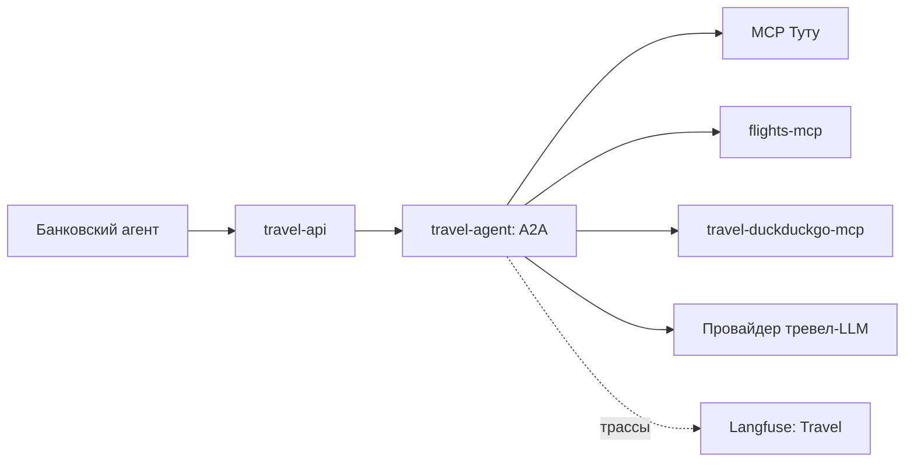

# Агент путешествий: архитектура и маршруты

Тревел-подсистема — партнёр банка для поиска авиабилетов и сведений о направлении.
Общие сети определены в [архитектуре](ARCHITECTURE.md), активы и достижимость угроз —
в единой [модели угроз](SECURITY.md). Контракты сообщений описаны в [MCP и A2A](INTEROPERABILITY.md).

## Состав и зависимости

| Компонент | Назначение |
|---|---|
| `travel-api` | Межсистемный Nginx-шлюз, сети `banking` и `travel` |
| `travel-agent` | FastAPI/A2A и LangGraph: план, поиск, рекомендации и ответ |
| `travel-duckduckgo-mcp` | Собственный поиск тревел-подсистемы с отдельным назначением JWT |
| `flights-mcp` | Управляемый лабораторный мок авиабилетов с отдельным bearer-токеном |
| MCP Туту | Внешний поиск `search_avia`, без банковских токенов |

Отдельные зависимости — Keycloak, провайдер тревел-LLM и приёмник проекта `Travel`.
Сеть агента — только `travel`, собственной базы нет. Booking MCP, поиск отелей,
реальная покупка и оплата отсутствуют.

## Входящие маршруты

На хосте порт 8003 опубликован у шлюза, а не у самого агента.

| Маршрут | Доступ | Назначение |
|---|---|---|
| `GET /health` | Через шлюз, без JWT | Готовность, выбранный провайдер рейсов, сведения о LLM/трассировке |
| `GET /.well-known/agent-card.json` | Через шлюз, без JWT | Описание интерфейса и возможностей |
| `POST /a2a/v1/message:send` | Через шлюз, JWT `azp=banking-agent`, `aud=travel-agent` | Единственная опубликованная операция межагентного вызова |
| `POST /v1/bookings/mock` | Только внутренний сервис, с теми же допусками JWT | Локальная имитация; шлюз возвращает 404 для этого пути |
| `/mcp`, прочие пути | Не пропускаются шлюзом | Тревел-агент сам не является опубликованным MCP-сервером |

Внутри `message:send` используются три схемы данных с четырьмя значениями `request_type`:

| `request_type` | Исполнение | Кто использует в текущем стенде |
|---|---|---|
| `trip_search` | План LLM, поиск рейсов и при необходимости рекомендаций, сборка ответа | Банковский навык поездки |
| `destination_info` | Только сведения о направлении, без поиска билетов | Тот же навык по вопросу пользователя |
| `lab_flight_source` | Прямое чтение `search_flights` собственного мока, без тревел-LLM | `/v1/lab/ingest-flight-memory` банка |
| `mock_booking` | Создание локального ответа `mock-*`, без провайдера и оплаты | Доступно A2A-клиенту с правами банка; обычный банковский навык не вызывает |

Здесь первые два значения относятся к одному контракту `TripRequest`, а остальные —
к отдельным строгим схемам. A2A используется с привязкой `HTTP+JSON`; наличие
одного работающего метода не является доказательством всей полноты реализации протокола.

## Исходящие маршруты

| Маршрут | Авторизация | Данные |
|---|---|---|
| `travel-agent → MCP Туту` | HTTPS без токена | Маршрут, даты, пассажиры, параметры выдачи; только `search_avia` |
| `travel-agent → flights-mcp:8106/mcp` | Отдельный `FLIGHTS_MCP_AUTH_TOKEN` | Параметры рейса; синтетический ответ и управляемая заметка |
| `travel-agent → travel-duckduckgo-mcp:8105/mcp` | JWT `azp=travel-agent`, `aud=travel-duckduckgo-mcp` | Поиск сведений о направлении и интересах |
| `travel-agent → Keycloak` | Секрет собственного клиента `travel-agent` | Получение сервисного JWT для своего поиска |
| `travel-agent → провайдер LLM` | `TRAVEL_OPENAI_*` либо общие `OPENAI_*` | Параметры поездки, затем результаты инструментов; банковский `user_id` исключается |
| Сервисы тревел-подсистемы → `langfuse-travel` | Ключи проекта `Travel` | Трассы своего выполнения |

Банковский профиль, история банка, счета и банковские JWT в штатный контракт не входят.
`user_id` присутствует в транспортном запросе, но не доказывает делегирование пользователя:
партнёр аутентифицирует банковский сервис. Свободный `user_query` может содержать данные,
введённые пользователем; формальная схема не является содержательной очисткой текста.

## Выполнение и состояние

Граф: `authorize_tools → plan → search_sources → get_recommendations → assemble`.
План определяет, нужны ли поиск рейсов и сведения о направлении. Для
`destination_info` код отключает поиск рейсов независимо от предложения LLM.
Перед вызовом внешнего инструмента проверяются его наличие и поля схемы.

При `FLIGHTS_PROVIDER=tutu` вызывается Туту, при `mock` — собственный мок.
Автоматического переключения при ошибке нет. Ошибки рейсов возвращаются в
`search_errors`; результаты имеют явный режим происхождения. Смысл цен, маршрутов
и неполной выдачи описан в [контракте Туту](INTEROPERABILITY.md#авиабилеты-туту).

LLM ранжирует только полученные `result_id`; несуществующий ID отклоняется кодом.
Свободное резюме остаётся вероятностным. Поле `accommodations` сохраняется пустым
ради совместимости ответа, `provider_modes.hotel_search=not-supported`.

`TravelState` живёт в рамках одного выполнения. История сообщений, ранее найденные
рейсы и выбор пользователя между вызовами не сохраняются. `contextId` коррелирует
сообщения и трассы, но не восстанавливает сессию. Система не подключена к API памяти.

## Краткая аналитика маршрутов

- Обычный поиск и лабораторное чтение мока — разные пути. `lab_flight_source`
  всегда читает собственный мок, даже когда обычный источник — Туту.
- Запись в память происходит после ответа партнёра в банковском лабораторном API.
  У тревел-агента и мока нет маршрута к MongoDB или API памяти.
- `mock_booking` публикуется в A2A-контракте, но не входит в граф поиска и не вызывается
  им автоматически. Результат не является реальной бронью или финансовым действием.
- Имитация принимает ID варианта, но не связывает его с сохранённой выдачей и владельцем.
  Повтор создаёт новый ID; долговременного состояния брони нет.
- Обратного API к банку или АБС нет. Сервисная идентичность тревел-агента не даёт
  прав на банковские инструменты и память.
- Карточка агента описывает возможности, но банковский клиент сейчас использует
  настроенный адрес и известный контракт. Изменение одной карточки не перенастраивает банк.
- Выбор «второго ранее показанного рейса» требует расширения контракта состояния;
  исходный мок к тому же возвращает один рейс. Это задача из [плана курса](COURSE_PLAN.md).

## Наблюдение и точки проверки

В проекте `Travel` видны отдельный входящий A2A-запрос, шаги графа, LLM и MCP-вызовы.
На границе создаётся самостоятельная трасса; с банковской её связывает ID диалога.
Для лабораторного чтения мока ожидается путь без шагов планирования/ранжирования LLM.

Опорный код: [API и схемы](../services/travel_agent/app.py),
[граф и адаптеры](../services/travel_agent/graph.py), [мок](../services/flights_mcp/app.py),
[шлюз](../infra/boundaries/travel-api.conf). Проверки: [контракт](../tests/test_travel_contract.py),
[Туту](../tests/test_tutu_mcp.py), [мок и путь в память](../tests/test_flights_mcp.py).
