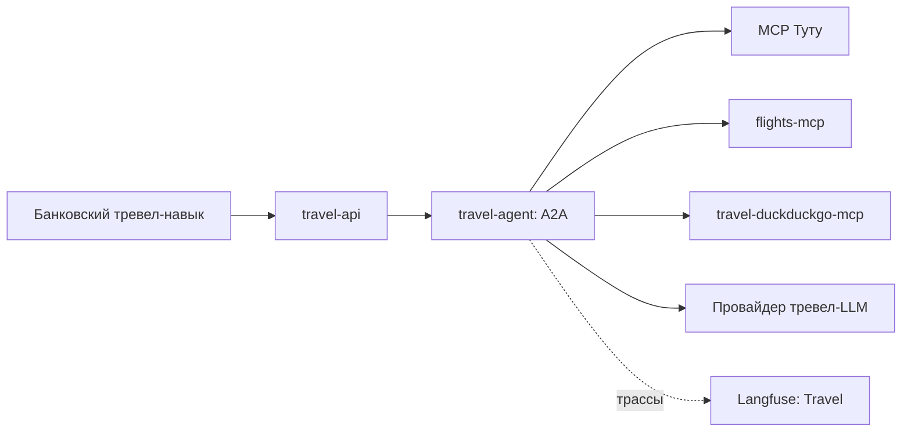

# Агент путешествий: архитектура и маршруты

Внешний `travel-agent` ищет авиабилеты, сведения о направлении и расходах.
Банковский `travel-skill` вызывает его по A2A со своими учётными данными OAuth.
Историю и память читает банковский навык; партнёр к памяти не подключён.

Сети описаны в [архитектуре](ARCHITECTURE.md), угрозы в [SECURITY.md](SECURITY.md),
контракты в [MCP и A2A](INTEROPERABILITY.md), состояние банковского навыка в
[BANKING_AGENT.md](BANKING_AGENT.md).

## Состав и зависимости

| Компонент | Назначение |
|---|---|
| `travel-api` | Межсистемный Nginx-шлюз, сети `banking` и `travel` |
| `travel-agent` | FastAPI/A2A и LangGraph: план, поиск, рекомендации и ответ |
| `travel-duckduckgo-mcp` | Собственный поиск тревел-подсистемы с отдельным назначением JWT |
| `flights-mcp` | Управляемый лабораторный мок авиабилетов с отдельным bearer-токеном |
| MCP Туту | Внешний поиск `search_avia`, без банковских токенов |

Агент использует Keycloak, своего провайдера LLM и приёмник проекта `Travel`.
Он подключён только к сети `travel`, собственной базы нет. Поиск отелей,
Booking MCP, реальная покупка и оплата не реализованы.

## Входящие маршруты

На хосте порт 8003 опубликован у шлюза, а не у самого агента.

| Маршрут | Доступ | Назначение |
|---|---|---|
| `GET /health` | Через шлюз, без JWT | Готовность, выбранный провайдер рейсов, сведения о LLM/трассировке |
| `GET /.well-known/agent-card.json` | Через шлюз, без JWT | Описание интерфейса и возможностей |
| `POST /a2a/v1/message:send` | Через шлюз, JWT `azp=travel-skill` с `travel.plan` либо `banking-agent`, `aud=travel-agent` | Единственная опубликованная операция межагентного вызова |
| `POST /v1/bookings/mock` | Только внутренний сервис, с теми же допусками JWT | Локальная имитация; шлюз возвращает 404 для этого пути |
| `/mcp`, прочие пути | Не пропускаются шлюзом | Тревел-агент сам не является опубликованным MCP-сервером |

Внутри `message:send` используются три схемы данных с пятью значениями `request_type`:

| `request_type` | Исполнение | Кто использует в текущем стенде |
|---|---|---|
| `trip_search` | План LLM, поиск рейсов и при необходимости рекомендаций, сборка ответа | `travel-skill`; в `legacy`: прежний навык поездки |
| `destination_info` | Только сведения о направлении, без поиска билетов | Тот же навык по вопросу пользователя |
| `budget_plan` | Сведения о расходах; поиск рейса при известных аэропортах и дате вылета | Банковский тревел-навык |
| `lab_flight_source` | Прямое чтение `search_flights` собственного мока, без тревел-LLM | `/v1/lab/ingest-flight-memory` банка |
| `mock_booking` | Создание локального ответа `mock-*`, без провайдера и оплаты | Доступно A2A-клиенту с правами банка; обычный банковский навык не вызывает |

Первые три значения относятся к `TripRequest`, остальные используют отдельные схемы.
Сервис реализует метод A2A `message:send` с привязкой `HTTP+JSON`.
Поддержка остальных методов протокола не заявлена.

## Исходящие маршруты

| Маршрут | Авторизация | Данные |
|---|---|---|
| `travel-agent → MCP Туту` | HTTPS без токена | Маршрут, даты, пассажиры, параметры выдачи; только `search_avia` |
| `travel-agent → flights-mcp:8106/mcp` | Отдельный `FLIGHTS_MCP_AUTH_TOKEN` | Параметры рейса; синтетический ответ и управляемая заметка |
| `travel-agent → travel-duckduckgo-mcp:8105/mcp` | JWT `azp=travel-agent`, `aud=travel-duckduckgo-mcp` | Веб-поиск сведений о направлении, расходах и интересах; ссылки на источники |
| `travel-agent → Keycloak` | Секрет собственного клиента `travel-agent` | Получение сервисного JWT для своего поиска |
| `travel-agent → провайдер LLM` | `TRAVEL_OPENAI_*` либо общие `OPENAI_*` | Параметры поездки, затем результаты инструментов; банковский `user_id` исключается |
| Сервисы тревел-подсистемы → `langfuse-travel` | Ключи собственного проекта `Travel` | Трассы своего выполнения |

Банковский профиль, история банка, счета и банковские JWT в штатный контракт не входят.
`user_id` присутствует в транспортном запросе, но не доказывает делегирование пользователя:
партнёр аутентифицирует банковский сервис. Свободный `user_query` может содержать
личные данные из сообщения; схема не очищает его содержимое.

## Выполнение и состояние

Граф: `authorize_tools → plan → search_sources → get_recommendations → assemble`.
План определяет, нужны ли поиск рейсов и сведения о направлении. Для
`destination_info` код отключает поиск рейсов независимо от предложения LLM.
Для `budget_plan` код включает поиск при известных `origin`, `destination_airport`
и `departure_date`. Конец пребывания (`stay_end_date`) отделён от обратного рейса;
`one_way=true` не допускает `return_date`. Отсутствующая дата не отправляется в Туту
как JSON `null`.
Перед вызовом внешнего инструмента проверяются его наличие и поля схемы.

При `FLIGHTS_PROVIDER=tutu` агент вызывает Туту, при `mock` вызывает свой мок.
Автоматического переключения при ошибке нет. Ошибки рейсов и поиска сведений возвращаются в
`search_errors`; результаты имеют явный режим происхождения. Смысл цен, маршрутов
и неполной выдачи описан в [контракте Туту](INTEROPERABILITY.md#авиабилеты-туту).

MCP веб-поиска использует DDGS (`provider=ddgs`). Движок задаёт `DDGS_TEXT_BACKEND`,
по умолчанию `bing`; название `travel-duckduckgo-mcp` не означает обращение к DuckDuckGo.
Адаптер различает `status=ok`, `empty` и `unavailable`. Тайм-аут, ограничение частоты
и ошибка провайдера сохраняются в `diagnostic`. Исключение `No results found.`
возвращается как пустая выдача.
При сетевом `ConnectError`/`ConnectTimeout` или разрыве протокола поиск Туту
повторяется один раз после 0,5 с; это повтор только чтения, не денежных операций.
Попытки записываются в `flight_search_meta.attempts`, а тип окончательной ошибки
сохраняется даже при пустом тексте исключения. A2A-ответ сохраняет
`destination_search_meta` и понятное пояснение в `agent_cautions`; пустая выдача
сама по себе не добавляется в `search_errors`. Для бюджета запросы посвящены
расходам, а не общему перечню достопримечательностей. При пустой выдаче или сбое
выполняется одна попытка с другим запросом; при ограничении частоты повтор не
выполняется. Запросы и статусы сохраняются в `destination_search_meta.attempts`.
Сбой MCP не уничтожает найденные рейсы. Отказы авторизации 401/403 возвращаются
ошибкой, без подмены недоступностью поиска.
Состояние, причина и результаты входят в трассы MCP и шагов Travel; для сбоя
провайдера наблюдение `search.provider` имеет уровень `WARNING`.

LLM ранжирует найденные рейсы; код отклоняет несуществующий `result_id`.
Если источники не вернули ни рейсов, ни сведений о направлении, агент возвращает
готовое объяснение пустой выдачи или сбоя без генерации неподтверждённых рекомендаций.
Свободное резюме остаётся вероятностным. Поле `accommodations` сохраняется пустым
ради совместимости ответа, `provider_modes.hotel_search=not-supported`.

`TravelState` живёт в рамках одного выполнения. История сообщений, ранее найденные
рейсы и выбор пользователя между вызовами не сохраняются. `contextId` коррелирует
сообщения и трассы, но не восстанавливает сессию. Система не подключена к API памяти.

## Краткая аналитика маршрутов

- Обычный поиск и лабораторное чтение мока выполняются разными путями. `lab_flight_source`
  всегда читает собственный мок, даже когда для обычного поиска выбран Туту.
- В основном режиме `travel-skill` ставит результат партнёра в очередь кандидатов
  памяти; прежний лабораторный API отдельно сохраняет сырой ответ мока в
  `banking-agent`. Это разные области и авторы. У партнёра и мока нет маршрута к памяти.
- `mock_booking` публикуется в A2A-контракте, но не входит в граф поиска и не вызывается
  им автоматически. Результат не является реальной бронью или финансовым действием.
- Имитация принимает ID варианта, но не связывает его с сохранённой выдачей и владельцем.
  Повтор создаёт новый ID; долговременного состояния брони нет.
- Обратного API к банку или АБС нет. Сервисная идентичность тревел-агента не даёт
  прав на банковские инструменты и память.
- Карточка агента описывает возможности, но банковский клиент сейчас использует
  настроенный адрес и известный контракт. Изменение одной карточки не перенастраивает банк.
- Выбор «второго ранее показанного рейса» требует расширения контракта состояния;
  исходный мок к тому же возвращает один рейс. Это задача из [плана курса](COURSE_PLAN.md).

## Наблюдение и точки проверки

В собственном проекте `Travel` один входящий A2A-запрос создаёт одну трассу:
OAuth, обработчик, граф, LLM и MCP находятся внутри этого дерева.
`upstream_trace_id` и `upstream_span_id` связывают её с вызовом банка;
ключи банковского Langfuse партнёру не передаются. Прямой запрос без родителя
создаёт обычную локальную трассу. Метки опыта и ID диалога служат для поиска.
Для лабораторного чтения мока ожидается путь без шагов планирования/ранжирования LLM.

Опорный код: [API и схемы](../services/travel_agent/app.py),
[граф и адаптеры](../services/travel_agent/graph.py), [мок](../services/flights_mcp/app.py),
[шлюз](../infra/boundaries/travel-api.conf). Проверки: [контракт](../tests/test_travel_contract.py),
[Туту](../tests/test_tutu_mcp.py), [мок и путь в память](../tests/test_flights_mcp.py).
