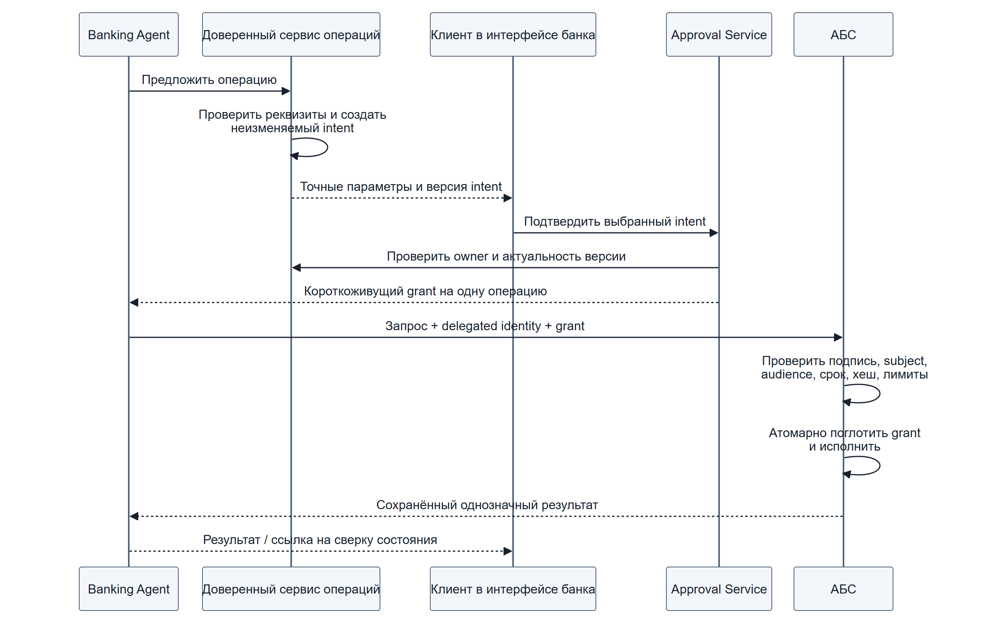

# Подтверждение банковской операции одноразовым разрешением

Статус: предложение, не реализовано в проверенной версии `5b28bd4`.

Текущий механизм проверяет подтверждение в банковском агенте. Прямой денежный вызов MCP с допустимым JWT может миновать эту проверку. Проверка владельца счёта в АБС не заменяет согласие на конкретную операцию. См. [протокол проверки](../verification/RESULTS-2026-11-12.md).

## Предлагаемый процесс

[Исходник Mermaid](diagrams/operation-approval-sequence.mmd). Источник: `alfa2/artifacts/work2-figure-1.mmd`.

1. Доверенный сервис проверяет параметры и сохраняет неизменяемое поручение (`intent`) с версией.
2. Клиент видит точные параметры и подтверждает выбранное поручение.
3. Approval Service проверяет владельца и версию, выдаёт краткоживущее одноразовое разрешение (`grant`).
4. АБС проверяет подпись, subject, audience, срок, хеш параметров и лимиты; атомарно поглощает разрешение и исполняет операцию.
5. Результат сохраняется для однозначного ответа и сверки состояния при повторном запросе.

## Что требуется разработать и проверить

Сервис поручений и выдачи разрешений, проверку grant на стороне исполнителя и атомарность его поглощения. Нужно определить поведение при повторе и сбое, проверить отказ при подмене параметров, владельца, адресата, истечении срока и повторном использовании разрешения.

[Существующий финансовый поток](../diagrams/bp1-current-sequence.svg) описан отдельно и не включает предлагаемый сервис grant.
